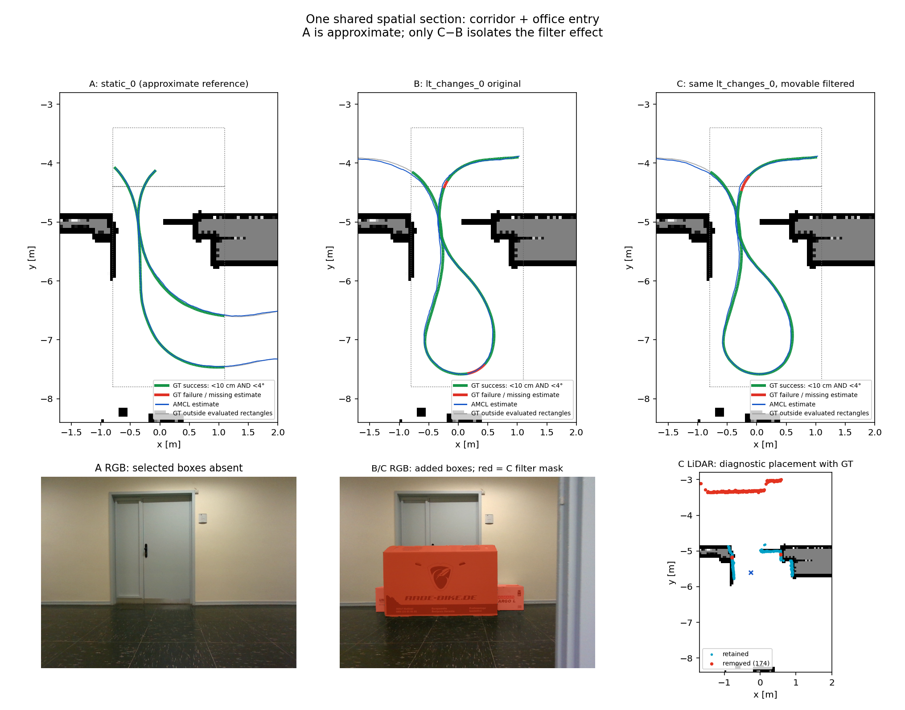

# AMCL: A / B / C — prvi skupni prostorski odsek

**A je približna referenca.** Poti se razlikujeta; spodaj so ocenjene samo vnaprej določene iste pravokotne prostorske regije. A is an approximate spatial reference: static_0 travels farther east inside the office and spends different times in each area. Evaluate only the predeclared common corridor and office-entry rectangles; C-A is descriptive, not a paired causal filter effect. B/C reuse the previously selected unchanged 30-second pilot.

**Predmeti:** Large Rabe-Bike cardboard box and the two smaller boxes in front of the same closed door: absent in selected static_0 RGB, present in lt_changes_0 view-000044.

A: `static_0` 1733376760–1733376800; B/C: `lt_changes_0` 1733414028–1733414058. Izbira temelji na GT poti in RGB, pred zagonom A. B/C sta nespremenjena prejšnja pilota. B = prejšnji A; C = prejšnji B.



| Prostor | Zagon | Uspešne / ocenljive poze | Uspeh [%] | RMSE položaj [cm] | RMSE yaw [°] | Veljavna maska [%] |
|---|---|---:|---:|---:|---:|---:|
| Skupni del hodnika | A | 29/29 | 100.00 | 2.742 | 2.268 | 0.00 |
| Skupni del hodnika | B | 65/68 | 95.59 | 2.401 | 2.102 | 5.88 |
| Skupni del hodnika | C | 61/68 | 89.71 | 2.501 | 2.201 | 5.88 |
| Vhodni del pisarne | A | 262/262 | 100.00 | 3.861 | 1.969 | 0.00 |
| Vhodni del pisarne | B | 284/301 | 94.35 | 4.481 | 2.203 | 1.66 |
| Vhodni del pisarne | C | 297/301 | 98.67 | 4.445 | 2.225 | 1.66 |
| Skupni odsek skupaj | A | 291/291 | 100.00 | 3.765 | 2.001 | 0.00 |
| Skupni odsek skupaj | B | 349/369 | 94.58 | 4.176 | 2.185 | 2.44 |
| Skupni odsek skupaj | C | 358/369 | 97.02 | 4.156 | 2.221 | 2.44 |

| Prostor | Razlika | Uspeh [odstotne točke] | RMSE položaj [cm] | RMSE yaw [°] |
|---|---|---:|---:|---:|
| Skupni del hodnika | C–B: učinek filtra | -5.88 | +0.101 | +0.099 |
| Skupni del hodnika | C–A: približna referenca | -10.29 | -0.240 | -0.068 |
| Vhodni del pisarne | C–B: učinek filtra | +4.32 | -0.036 | +0.022 |
| Vhodni del pisarne | C–A: približna referenca | -1.33 | +0.584 | +0.257 |
| Skupni odsek skupaj | C–B: učinek filtra | +2.44 | -0.020 | +0.036 |
| Skupni odsek skupaj | C–A: približna referenca | -2.98 | +0.391 | +0.220 |

Uspeh zahteva hkrati položaj **<10 cm** in absolutni yaw **<4°**. Manjkajoča ocena ob GT šteje kot neuspeh. Sive poti so zunaj ocenjevanih regij. A ne uporablja mask; B prikazuje razpoložljivost istih časovno veljavnih mask kot C, vendar jih ne uporabi.

C–B je parjena primerjava istih skenov in časov. C–A je opisna razlika med različnima vožnjama; različna pot, trajanje in prisotni ljudje preprečujejo sklep, da je vsa razlika posledica izbranih škatel. Na sliki je zanesljivo vidna odsotnost/prisotnost škatel, ne potrjena nespremenjenost vseh drugih predmetov.

AMCL 1.3.12, isti uradni zemljevid, nastavitve in seme 42. Prva GT poza vsake vožnje služi inicializaciji, kasnejši GT samo oceni/prikazu. Brez poravnave trajektorij. B/C ohranita isto odometrijo in inicializacijo; odstranjenih je 789 zadetkov v celotnem intervalu B/C. Veljavna maska obstaja na 11/450 skenih. Rdeči LiDAR zadetki v spodnjem panelu so **diagnostično postavljeni z GT**, ne z AMCL oceno.

Ponovitev (cache se ponovno uporabi; za nov A spremeni `output` v kopiji konfiguracije):

```bash
python3 -m llm_object_classifier.localization_comparison --config configs/lilocbench-abc.json
```

Nastavitve in prostorske meje: [konfiguracija](../../configs/lilocbench-abc.json). [Strojno berljive metrike](metrics.json). Celotni lokalni izhodi: `results/lilocbench-abc/`; podatki/cache ostajajo lokalno.

Viri: [LILocBench](https://www.ipb.uni-bonn.de/html/projects/localization_benchmark/), [uradni evaluator](https://github.com/PRBonn/LILocBench). RGB in referenčni zemljevid: Trekel et al., LILocBench (2025), [CC BY-NC-SA 4.0](https://creativecommons.org/licenses/by-nc-sa/4.0/); sestavljena slika je objavljena pod isto licenco.
