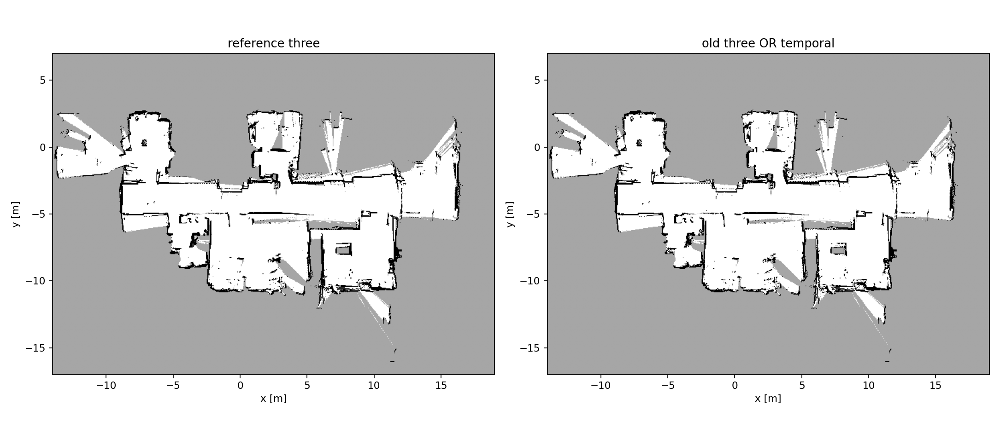
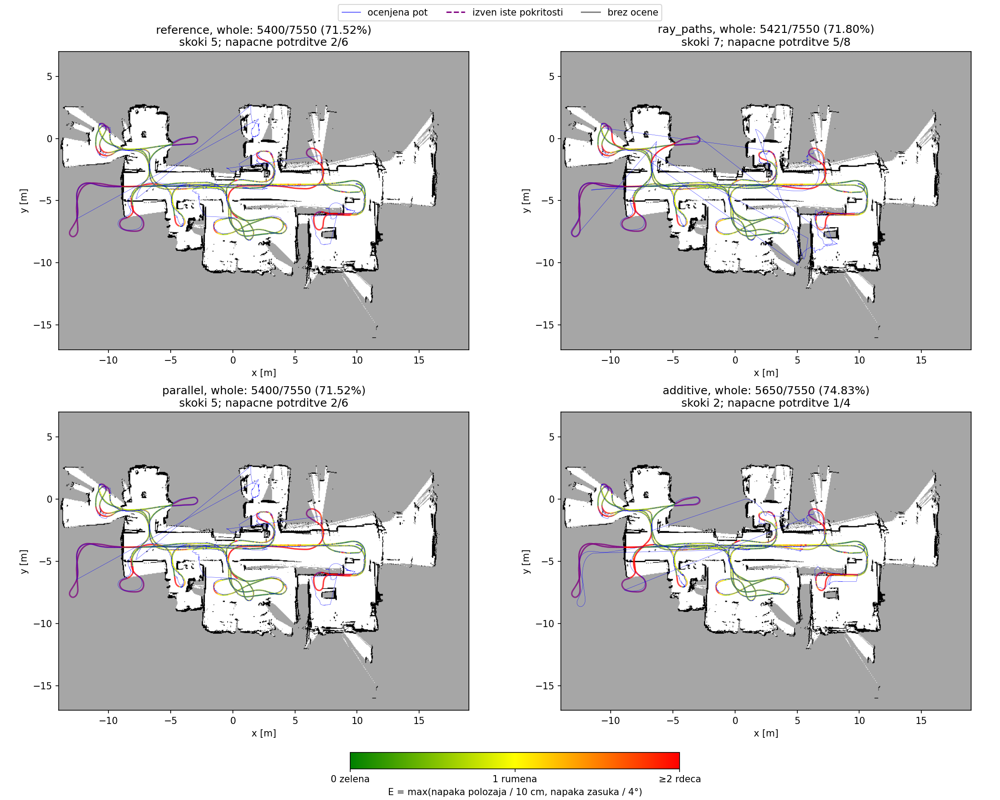
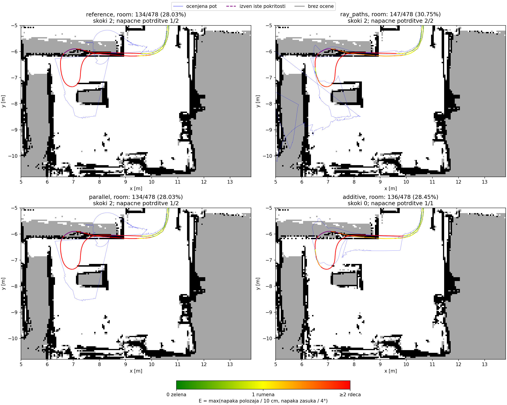

# Tri ločene ablacijske primerjave lokalizacije

Izhodišče `f4631d0`; referenca je prejšnji filter treh kamer in lokalizator s potrjevanjem iz `695570a`. Ponovno uporabljen je njegov celotni preverjeni zagon. Vsaka nova različica je izvedena enkrat, po tehničnem preizkusu prvih 120 skenov. Brez nove Florence/Qwen/SAM/AMCL inference. Nastavitve in vhodi so vnaprej zamrznjeni v [protocol.json](protocol.json).

1. **ray_paths**: ista referenčna mreža in potrjevanje. Hitro grobo/srednje/fino ocenjevanje endpointov ostane enako; vseh največ 16 ohranjenih vrhnjih globalnih hipotez dobi dodatno preverjanje poti 192 enakomerno izbranih žarkov. Izhodišče je uradna LiDAR translacija v base_link, ne izhodišče robota. Korak 2,5 cm; prvih in zadnjih 20 cm se ne kaznuje. Samo znane occupied celice pred izmerjenim koncem štejejo kot ovira; unknown in free sta nevtralna. Kazen žarka raste z manjkajočo razdaljo in saturira po 0,5 m, povprečna kazen kandidata je omejena na 0,20. Imenovalec so vsi izbrani veljavni žarki. Score = endpoint score − path penalty; nato isti sprejem in isto potrjevanje. Množica kandidatov se ne skrajša, zato se učinek ne meša z drugo nastavitvijo iskanja.

2. **parallel**: ista referenčna mreža in endpoint matcher. Med oddaljenim predlogom aktivna lokalna poza nadaljuje normalno LiDAR sledenje. Obe hipotezi prejmeta isto relativno odometrijo in isti trenutni sken. Oddaljena mora poleg vseh dosedanjih pogojev potrditve presegati najboljšo lokalno oceno za ≥0,03 vsaj 3 zaporedne skene. Če se lokalni fit obnovi in prednost izgine, se predlog prekliče. Čakanje je omejeno na 2 s; po izteku se ohrani lokalna pot. Pri neznanem začetku brez lokalne hipoteze ostane prejšnje potrjevanje. Noben GT podatek ne odloča o preklopu.

3. **additive**: spremeni se samo mreža, lokalizator je nespremenjena referenca s kolesno odometrijo in potrjevanjem. Maska je old_three OR temporal_confirmed_without_fixed. Vse stare odstranitve ostanejo, dodatne v celicah s fixed so prepovedane. Ponovna vključitev je preverjeno nič za vse surove beam ID-je. Vsak odstranjen žarek je v celoti izpuščen iz integracije; ne ustvari prostega prostora za predmetom. Rekonstruirana referenčna mreža je celico za celico enaka izvirniku.

Vsi obdelajo vseh 8982 `static_0` skenov po vrsti, brez resetov na mejah pokritosti. Glavna tabela uporablja samo istih **7550** pokritih GT poz in **478** sobnih; izločeno 1426 nezmapiranih GT poz, v sobi 38; dodatnih 6 skenov nima GT. GT služi samo naknadni evalvaciji in izrisu. Uspeh: položaj <10 cm IN zasuk <4°, tudi za negotovo odometrijsko napoved. Manjkajoča ocena je neuspeh. P95 je nad razpoložljivimi ocenami. Skok >1 m šteje, če sta obe sosednji GT pozi v skupni maski.

Napačna globalna potrditev: `confirmation_event=confirmed` pri GT v maski, kjer oba praga uspeha nista izpolnjena; vključuje tudi začetno potrditev. Bližnji globalni sprejemi so šteti ločeno v CSV. Čas do ponovne lokalizacije: po vsaj 1 s napake iščemo vsaj 1 s neprekinjenega uspeha; zakasnitev teče do začetka tega stabilnega uspeha. Epizode ob izstopu iz pokritosti/GT/sobe so cenzurirane, ne pretvorjene v uspeh. Algoritem se na teh mejah ne resetira. Tabela daje mediano/P95 samo za obnovljene epizode in posebej število cenzuriranih.

Čas izvajanja je vsota merjenih stenskih časov pretvorbe skena in ujemanja (`processing_sum_s`), brez enkratne priprave polj in I/O izvoza. Referenčni čas je shranjen iz prejšnjega zagona. Novi trije procesi tečejo sočasno na CPU, po ena BLAS nit na proces; časi niso ponavljan kontroliran mikrobenchmark. CSV doda mediano/P95 časa na sken ter prvo pravilno pozo. Izvedba je deterministična, seme 42.

| Različica / območje | Uspeh n/N (%) | P95 [cm / °] | Skoki >1m | Napačne globalne potrditve | Obnova med/P95 [s] | Obnovljene / cenzurirane | Izračun [s] |
|---|---:|---:|---:|---:|---:|---:|---:|
| reference / whole | 5400/7550 (71.52) | 309.84 / 8.27 | 5 | 2/6 | 3.67/19.96 | 15 / 8 | 159.16 |
| reference / room | 134/478 (28.03) | 258.28 / 108.54 | 2 | 1/2 | 3.27/3.27 | 1 / 3 | 159.16 |
| ray_paths / whole | 5421/7550 (71.80) | 195.90 / 10.71 | 7 | 5/8 | 3.67/13.23 | 17 / 8 | 163.47 |
| ray_paths / room | 147/478 (30.75) | 258.06 / 110.12 | 2 | 2/2 | 3.13/3.13 | 1 / 3 | 163.47 |
| parallel / whole | 5400/7550 (71.52) | 309.84 / 8.27 | 5 | 2/6 | 3.67/19.96 | 15 / 8 | 156.94 |
| parallel / room | 134/478 (28.03) | 258.28 / 108.54 | 2 | 1/2 | 3.27/3.27 | 1 / 3 | 156.94 |
| additive / whole | 5650/7550 (74.83) | 56.81 / 8.58 | 2 | 1/4 | 3.80/13.51 | 15 / 9 | 156.81 |
| additive / room | 136/478 (28.45) | 60.22 / 8.91 | 0 | 1/1 | 3.20/3.20 | 1 / 3 | 156.81 |

Samostojni učinek `ray_paths` na isti pokriti poti: uspeh +0.28 odstotne točke, skoki 5 → 7, napačne globalne potrditve 2 → 5. Ne gre za kombinacijo sprememb ali statistično oceno več ponovitev.

Samostojni učinek `parallel` na isti pokriti poti: uspeh +0.00 odstotne točke, skoki 5 → 5, napačne globalne potrditve 2 → 2. Ne gre za kombinacijo sprememb ali statistično oceno več ponovitev.

Samostojni učinek `additive` na isti pokriti poti: uspeh +3.31 odstotne točke, skoki 5 → 2, napačne globalne potrditve 2 → 1. Ne gre za kombinacijo sprememb ali statistično oceno več ponovitev.

| Dodatni filter / območje | Dodatno odstranjeni odvečni | Izgubljeni ujemajoči | Odvečni prej → potem | Ujemajoči prej → potem | Ponovno vključeni |
|---|---:|---:|---:|---:|---:|
| whole | 13675 | 42287 | 486280 → 472605 | 4458100 → 4415813 | 0 |
| room | 9031 | 14875 | 149563 → 140532 | 673835 → 658960 | 0 |

Geometrija uporablja vse gt-kompenzirane `lt_changes_0` konce žarkov in neodvisni `mapping`: ujemanje ≤10 cm; odvečno samo v potrjeno prostem prostoru. Ne gre za GT semantične oznake. Soba je isti endpoint pravokotnik kot prej.





GT: E=max(napaka položaja/10 cm, napaka zasuka/4°), zelena 0, rumena 1, rdeča ≥2. Vijolično črtkano je izven iste pokritosti, siva brez ocene; tanka modra je celotna ocenjena pot.

[Poze](poses.csv) · [Povzetek](summary.csv) · [Globalne potrditve](confirmation-events.csv) · [Epizode izgube in obnove](relocalization-episodes.csv) · [Žarkovni kandidati](ray-candidates.csv) · [Vzporedni oceni](parallel-comparisons.csv) · [Dodatna geometrija](additive-geometry.csv) · [Revizija maske](map-audit.json) · [Preverjanje](validation.json).

## Ponovitev

```bash
OPENBLAS_NUM_THREADS=1 MPLCONFIGDIR=/tmp/mpl-lilocbench python3 maintenance/run_localization_ablations.py --stage prepare
OPENBLAS_NUM_THREADS=1 MPLCONFIGDIR=/tmp/mpl-lilocbench python3 maintenance/run_localization_ablations.py --stage smoke
OPENBLAS_NUM_THREADS=1 MPLCONFIGDIR=/tmp/mpl-lilocbench python3 maintenance/run_localization_ablations.py --stage full
```

Potrebuje shranjene skene/odometrijo/kalibracijo static_0, mrežo treh kamer ter referenčne potrjene CSV iz `data/lilocbench-relocalization/full`, projekcijsko masko starega filtra in časovno masko/evidence iz `data/lilocbench-temporal-cells`. Vsi ostanejo lokalno, brez novih uteži. Za novo ponovitev uporabi novo output/cache mapo v `configs/lilocbench-ablations.json`. LILocBench, Trekel et al., IROS 2025, CC BY-NC-SA 4.0.

Dodatna revizija: v 44 vzporednih preverjanjih se je lokalni fit obnovil 0-krat. Zato je v tem naboru vzporedna različica dala povsem iste ocenjene poze kot referenca; preklic ob obnovi je preverjen s sintetičnim testom, ne potrjen z naravno epizodo tega posnetka. Žarkovna kazen spremeni prvo uvrščeno hipotezo pri 12/40 globalnih iskanjih.

Epizode izgube so določene iz napak posamezne različice, zato niso isti parni izpadi; časi obnove so opisni in vedno opremljeni s številom obnovljenih/cenzuriranih. [Natančne globalne odločitve](global-decisions.csv) in [časi izvajanja](runtime.csv). Referenčni celotni stenski čas ni bil shranjen; vsota processing_s je na voljo.

Preverjanje izvoza: `OPENBLAS_NUM_THREADS=1 python3 maintenance/validate_localization_ablations.py`.
