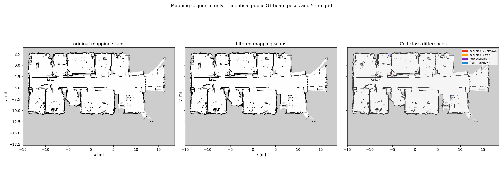
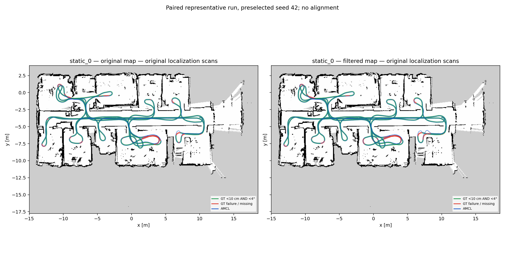
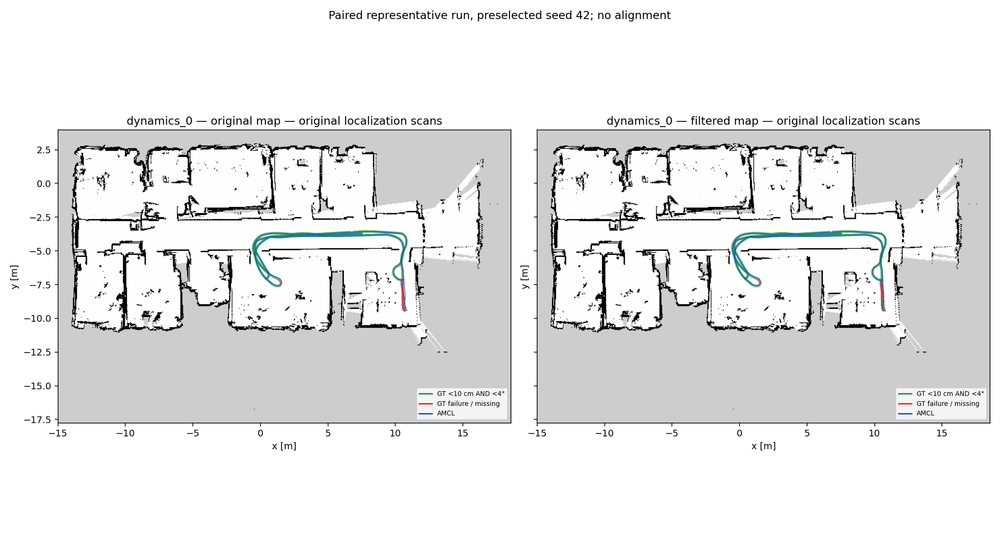
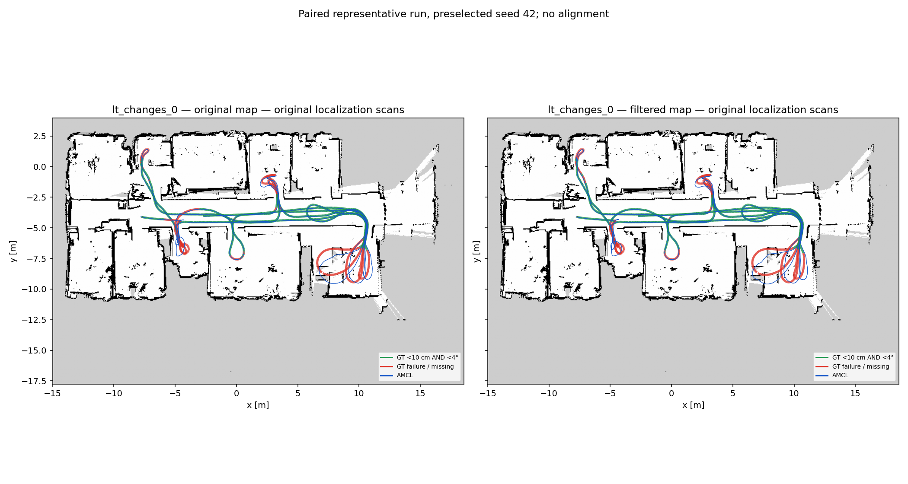
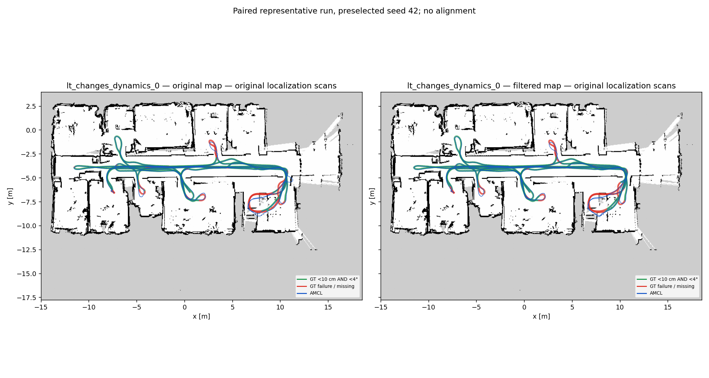

# LILocBench: filtriranje med gradnjo zemljevida

Dva lastna zemljevida izključno iz `mapping`; na obeh isti originalni lokalizacijski skeni. Deset parov na vsako sekvenco, semena 42–51. Filter ni uporabljen med lokalizacijo.



| Sekvenca | Zemljevid | RMSE položaja [cm] | Max [cm] | <5 cm [%] | <10 cm [%] | RMSE yaw [°] | Max yaw [°] | <2° [%] | <4° [%] | Oba: <10 cm in <4° [%] |
|---|---|---:|---:|---:|---:|---:|---:|---:|---:|---:|
| static_0 | original | 6.32 ± 0.33 | 38.00 ± 7.38 | 62.25 ± 1.52 | 93.21 ± 0.35 | 1.89 ± 0.05 | 8.00 ± 1.69 | 73.43 ± 0.86 | 95.24 ± 0.50 | 89.40 ± 0.56 |
| static_0 | filtered | 6.65 ± 0.68 | 41.32 ± 10.94 | 60.84 ± 1.66 | 93.22 ± 0.61 | 1.90 ± 0.05 | 8.31 ± 1.24 | 72.79 ± 0.81 | 95.17 ± 0.51 | 89.35 ± 0.72 |
| static_0 | paper_AMCL | 3.12 ± 0.05 | 7.72 ± 0.45 | 93.87 ± 0.73 | 100.00 ± 0.00 | 1.86 ± 0.01 | 5.39 ± 0.30 | 70.39 ± 0.44 | 96.78 ± 0.20 | ni podano |
| dynamics_0 | original | 6.10 ± 0.21 | 17.29 ± 1.14 | 60.14 ± 3.08 | 88.50 ± 1.74 | 1.55 ± 0.06 | 6.09 ± 0.24 | 81.54 ± 1.87 | 96.16 ± 0.52 | 86.92 ± 1.77 |
| dynamics_0 | filtered | 5.86 ± 0.18 | 16.85 ± 1.65 | 61.65 ± 3.27 | 90.08 ± 1.79 | 1.54 ± 0.07 | 6.35 ± 0.75 | 82.36 ± 2.05 | 96.07 ± 0.66 | 88.22 ± 1.57 |
| dynamics_0 | paper_AMCL | 3.21 ± 0.20 | 8.56 ± 0.51 | 89.56 ± 2.42 | 100.00 ± 0.00 | 1.87 ± 0.02 | 4.83 ± 0.21 | 73.57 ± 0.57 | 95.28 ± 1.18 | ni podano |
| lt_changes_0 | original | 23.12 ± 2.51 | 101.49 ± 12.50 | 43.08 ± 1.83 | 66.20 ± 0.93 | 7.39 ± 0.52 | 38.66 ± 3.04 | 55.14 ± 1.05 | 74.60 ± 1.52 | 62.19 ± 1.16 |
| lt_changes_0 | filtered | 64.52 ± 63.98 | 186.82 ± 129.92 | 37.19 ± 8.41 | 59.21 ± 11.21 | 7.45 ± 0.58 | 37.73 ± 3.49 | 51.80 ± 5.90 | 70.76 ± 5.61 | 55.48 ± 10.83 |
| lt_changes_0 | paper_AMCL | 13.51 ± 0.74 | 70.30 ± 5.23 | 61.41 ± 1.84 | 82.89 ± 0.79 | 4.49 ± 0.31 | 25.31 ± 2.91 | 61.56 ± 0.66 | 84.01 ± 0.85 | ni podano |
| lt_changes_dynamics_0 | original | 12.26 ± 0.88 | 64.55 ± 9.95 | 53.29 ± 1.61 | 82.90 ± 1.41 | 2.54 ± 0.12 | 13.90 ± 1.49 | 72.00 ± 1.07 | 90.52 ± 0.56 | 79.85 ± 1.33 |
| lt_changes_dynamics_0 | filtered | 17.49 ± 14.43 | 84.21 ± 54.18 | 52.66 ± 3.01 | 81.77 ± 3.11 | 2.84 ± 0.68 | 16.40 ± 5.84 | 71.88 ± 2.32 | 90.04 ± 2.11 | 78.60 ± 2.94 |
| lt_changes_dynamics_0 | paper_AMCL | 11.13 ± 1.68 | 72.07 ± 18.53 | 64.18 ± 1.33 | 87.34 ± 0.96 | 2.75 ± 0.22 | 20.34 ± 2.85 | 68.54 ± 0.62 | 90.09 ± 0.61 | ni podano |

Povprečje ± populacijski standardni odklon (`ddof=0`), n=10. Članek ne podaja skupnega AND deleža.

| Sekvenca | Filtriran − original: skupni uspeh [odstotne točke, parno povprečje ± std] |
|---|---:|
| static_0 | -0.04 ± 0.66 |
| dynamics_0 | 1.30 ± 1.57 |
| lt_changes_0 | -6.71 ± 11.22 |
| lt_changes_dynamics_0 | -1.25 ± 3.47 |

Mapping: 12180 skenov, 4060 RGB pri ~5 Hz; veljavna maska 5653 skenov (46.41 %). Odstranjenih 238993 / 9784946 veljavnih zadetkov (2.442 %). Spremenjenih 248 klasificiranih celic oziroma 1230 celic z drugačnim log-odds.

## Metoda in razlike glede na tabelo III

Uporabljena je obstoječa ROS2 Nav2 AMCL 1.3.12 z omnidirekcijskim gibalnim modelom, likelihood field, 100 žarki, 1.000–10.000 delci in pilotnimi parametri. Vsak par ima isto seme, originalne skene, odometrijo in prvo veljavno GT pozo za inicializacijo; začetni std je 0,2 m / 0,2 m / 10°. Poznejši lokalizacijski GT se uporablja samo za ocenjevanje/prikaz. Brez poravnave trajektorij, tuninga ali glasovanja.

Članek uporablja uradni zemljevid s scan-matching/pose-graph izboljšavo poz mapping. Tu oba lastna zemljevida uporabljata neposredne javne planarno interpolirane GT poze na čas vsakega žarka, brez te izboljšave. Log-odds mreža 5 cm ima enake meje, model zadetka/prostega prostora in pragove. Na celico je dovoljena ena posodobitev na sken; zadetek ima prednost pred prostim prostorom. Odstranjeni in neveljavni žarki ne posodabljajo mreže niti pred niti za zadetkom. Druge meritve lahko celice neodvisno opazujejo. GT vrzeli se na obeh zemljevidih izpustijo enako.

Florence-2 large FP16 → Qwen3.5 27B Q4_K_M prek lokalne Ollame → SAM 2.1 Hiera Small. Oznaka posamezne slike, RGB ~5 Hz, najbližja shematsko veljavna maska ±50 ms od sredine skena. Obstoječa časovno kompenzirana projekcija s kalibracijo. Odstrani se unija `movable` minus unija `fixed`/`uncertain`/manjkajočih/konfliktnih mask; prekrivanje ima zaščitno pravilo. Kontekstni preskoki in neveljavne sheme ostanejo v cache in se ne popravljajo.

Maske in oba zemljevida so zamrznjeni za vseh deset parov; standardni odklon opisuje variabilnost AMCL, ne negotovosti klasifikacije. Pokritost mask je delna: skeni brez veljavne maske ostanejo originalni in lahko iste premične predmete še vedno vpišejo v zemljevid. Zato ta preizkus ne pomeni popolne odstranitve vseh premičnih predmetov. Uporabljena je obstoječa 2D–RGB projekcija brez dodatnega preverjanja zakrivanja z globino.

Obnovitev transporta brez prejetega odgovora: 1. Neuspešni transporti so arhivirani; nadaljevanje preveri isti model in nastavitve. Že prejetih odgovorov, kontekstnih preskokov ali napak sheme nismo ponavljali.

Uradne numerične funkcije 2D APE so ponovno uporabljene pri časih vseh skenov. GT se interpolira brez ekstrapolacije ali vrzeli nad 150 ms. Manjkajoča ocena z GT šteje kot neuspeh pri deležih; RMSE/max uporabljata razpoložljive pare. Števila manjkajočih ocen in časov brez GT so v metrics.json za vsak zagon. To ponovi AMCL del eksperimentalnega načrta tabele III, vendar zaradi lastne gradnje zemljevida in ROS2/pilotnih parametrov ni bitno enaka reprodukcija avtorjeve implementacije. Učinek filtra ocenjujemo izključno s parno razliko naših dveh zemljevidov.

## Trajektorije

Slike kažejo vnaprej izbrano seme 42; tabelo tvori vseh 10 semen. Modro: AMCL; zeleno: GT, kjer sta hkrati dosežena oba stroga praga; rdeče: ostalo. Enako merilo in izrez znotraj vsakega para.









## Ponovitev

```bash
python3 -m llm_object_classifier.localization_filtered_map --config configs/lilocbench-filtered-map.json
```

Posamezni koraki: `--stage prepare`, `preflight`, `models`, `maps`, `amcl`, `report`. Zaključene inference, maske, integracija mreže in AMCL zagoni se ponovno uporabijo. Dnevniki in progress.json so v results/lilocbench-filtered-map/. Podatki, modeli, surovi izhodi in lokalna HTML galerija niso v Git.

Lokalna galerija: `/home/student/jakob/Klasifikacija-to-k/results/lilocbench-filtered-map/gallery/index.html`. Galerija prikaže originalni RGB, okvirje/oznake, SAM maske (odstranitev rdeča, fixed zelena, uncertain siva) in dejansko odstranjene mapping zadetke. LiDAR primerjave uporabljajo GT samo za diagnostiko in prikazujejo iste originalne lokalizacijske zadetke na obeh zemljevidih.

[Metrike vseh ponovitev](metrics.json), [protokol](protocol.json), [kratek preizkus](preflight.json).

Viri: [članek, tabela III](https://www.ipb.uni-bonn.de/wp-content/papercite-data/pdf/trekel2025iros.pdf), [uradni podatki, GT in navodila za zemljevide](https://www.ipb.uni-bonn.de/html/projects/localization_benchmark/), [evaluator](https://github.com/PRBonn/LILocBench). Trekel et al., IROS 2025. Zemljevidi in izpeljane slike: [CC BY-NC-SA 4.0](https://creativecommons.org/licenses/by-nc-sa/4.0/).
