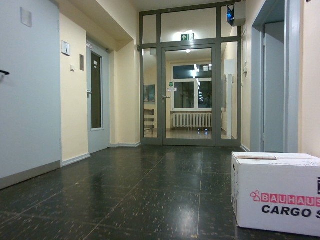
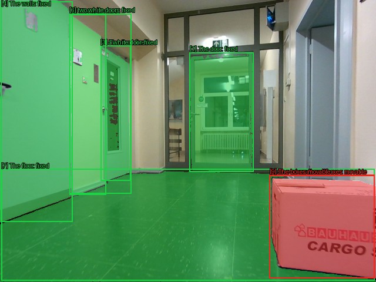
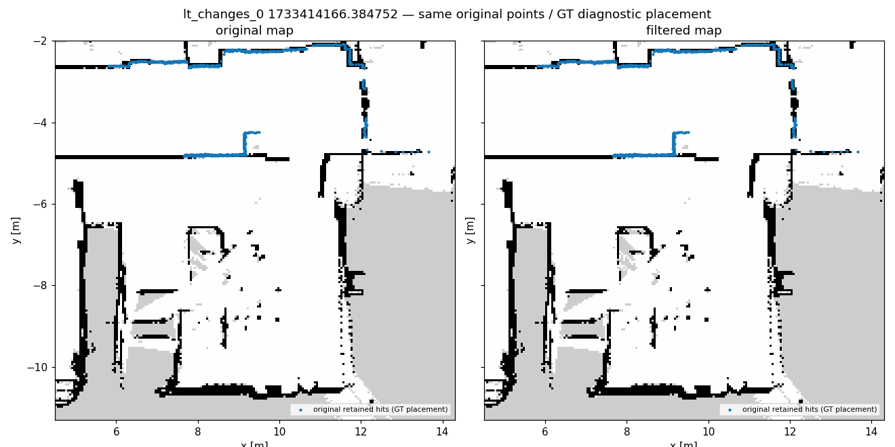
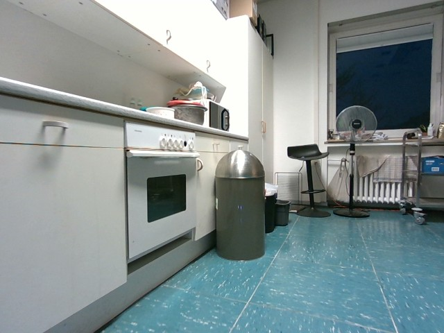
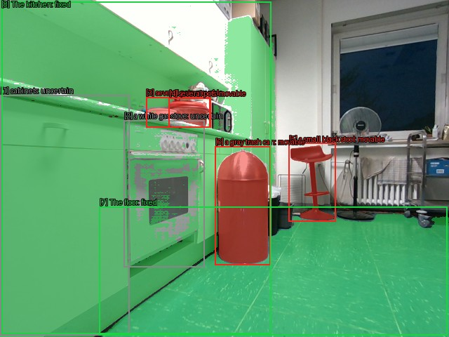
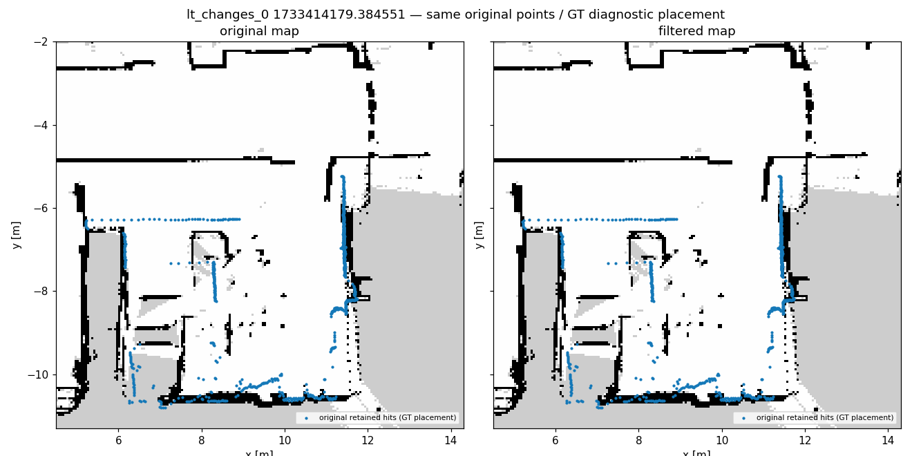

# LILocBench: kaj je prineslo semantično filtriranje LiDAR

Povzetek shranjenih preizkusov · 12. november 2026

## 1. Kaj smo testirali in kdaj smo filtrirali

Pipeline: Florence-2 large opiše sliko in določi regije; Qwen3.5 27B Q4_K_M jih razvrsti v fixed, movable ali uncertain; SAM 2.1 Hiera Small izdela maske. Gemma3 27B je bila preizkušena kot zamenjava klasifikatorja. LLM prejme besedilo, ne fotografije. Oznake so napovedi modelov, ne ročno potrjene oznake.

| Preizkus | Kdaj se filtrira | Shranjen rezultat |
| --- | --- | --- |
| A/B/C, prostorske regije | C: med lokalizacijo, uradni zemljevid | C−B: hodnik −5,88; vhod pisarne +4,32 odst. točke |
| Celotni vožnji A/B/C | C: med lokalizacijo, RGB ~1 Hz | lt_changes_0: B 68,56 %, C 68,69 % skupnega uspeha |
| Qwen proti Gemma, 51 s | Med lokalizacijo, isti Florence/SAM | Brez filtra 74,12 %; Qwen 64,18 %; Gemma 64,44 % |
| Qwen RGB ~1 proti ~5 Hz, isti 51 s | Med lokalizacijo | 64,18 proti 67,84 %; brez filtra 74,12 % |
| Originalni proti filtriranemu mapping | Samo pri gradnji zemljevida | Štiri sekvence, 10 parov semen 42–51; tabela na str. 2 |

Prvi štirje preizkusi uporabljajo uradni zemljevid in seme 42. Prostorski A je približna referenca iz druge vožnje; le C−B je parna primerjava. Odsečni testi imajo novo inicializacijo na začetku 51 s, zato niso neposredno primerljivi z izrezom celotne vožnje. Skupni uspeh vedno zahteva položaj <10 cm IN yaw <4°.

V zadnjem preizkusu iz iste sekvence mapping zgradimo dva lastna zemljevida. Pri filtriranem odstranimo movable samo ob veljavni maski, v lokalizaciji pa na obeh ohranimo iste originalne skene. 12.180 mapping skenov, 4.060 RGB (~5 Hz), pokritost mask 46,41 %. Odstranjenih je 238.993/9.784.946 zadetkov (2,442 %); spremeni se 248 razredov celic oziroma 1.230 vrednosti log-odds.

Najbližja veljavna maska mora biti največ ±50 ms od sredine skena. Fixed/uncertain/manjkajoče ali konfliktne regije zaščitijo prekrivanje. Odstranjen žarek pri mapping ne posodobi niti zasedenosti niti prostega prostora. Brez maske ostane originalen. Pri lokalizacijskem filtriranju odstranitev pomeni NaN, vsi skeni pa ostanejo.

Ta dokument in galerija sta pripravljena iz obstoječih rezultatov in predpomnilnika. Noben model ali AMCL ni bil ponovno zagnan.

<!-- pagebreak -->

## 2. Rezultati po sekvencah in tabela III

S = static_0; D = dynamics_0; L = lt_changes_0; LD = lt_changes_dynamics_0. O = lasten originalni zemljevid, F = lasten filtrirani zemljevid, Č = AMCL iz tabele III članka. Vrednosti so povprečje ± std desetih zagonov; naši std so populacijski (ddof=0). Manjši RMSE/max in večji deleži so boljši.

### Položaj — enaki strogi pragovi kot v tabeli III

| Sekv. | Zemlj. | RMSE [cm] | Max [cm] | <5 cm [%] | <10 cm [%] |
| --- | --- | --- | --- | --- | --- |
| S | O | 6.32 ± 0.33 | 38.00 ± 7.38 | 62.25 ± 1.52 | 93.21 ± 0.35 |
| S | F | 6.65 ± 0.68 | 41.32 ± 10.94 | 60.84 ± 1.66 | 93.22 ± 0.61 |
| S | Č | 3.12 ± 0.05 | 7.72 ± 0.45 | 93.87 ± 0.73 | 100.00 ± 0.00 |
| D | O | 6.10 ± 0.21 | 17.29 ± 1.14 | 60.14 ± 3.08 | 88.50 ± 1.74 |
| D | F | 5.86 ± 0.18 | 16.85 ± 1.65 | 61.65 ± 3.27 | 90.08 ± 1.79 |
| D | Č | 3.21 ± 0.20 | 8.56 ± 0.51 | 89.56 ± 2.42 | 100.00 ± 0.00 |
| L | O | 23.12 ± 2.51 | 101.49 ± 12.50 | 43.08 ± 1.83 | 66.20 ± 0.93 |
| L | F | 64.52 ± 63.98 | 186.82 ± 129.92 | 37.19 ± 8.41 | 59.21 ± 11.21 |
| L | Č | 13.51 ± 0.74 | 70.30 ± 5.23 | 61.41 ± 1.84 | 82.89 ± 0.79 |
| LD | O | 12.26 ± 0.88 | 64.55 ± 9.95 | 53.29 ± 1.61 | 82.90 ± 1.41 |
| LD | F | 17.49 ± 14.43 | 84.21 ± 54.18 | 52.66 ± 3.01 | 81.77 ± 3.11 |
| LD | Č | 11.13 ± 1.68 | 72.07 ± 18.53 | 64.18 ± 1.33 | 87.34 ± 0.96 |

### Orientacija — absolutni yaw

| Sekv. | Zemlj. | RMSE [°] | Max [°] | <2° [%] | <4° [%] |
| --- | --- | --- | --- | --- | --- |
| S | O | 1.89 ± 0.05 | 8.00 ± 1.69 | 73.43 ± 0.86 | 95.24 ± 0.50 |
| S | F | 1.90 ± 0.05 | 8.31 ± 1.24 | 72.79 ± 0.81 | 95.17 ± 0.51 |
| S | Č | 1.86 ± 0.01 | 5.39 ± 0.30 | 70.39 ± 0.44 | 96.78 ± 0.20 |
| D | O | 1.55 ± 0.06 | 6.09 ± 0.24 | 81.54 ± 1.87 | 96.16 ± 0.52 |
| D | F | 1.54 ± 0.07 | 6.35 ± 0.75 | 82.36 ± 2.05 | 96.07 ± 0.66 |
| D | Č | 1.87 ± 0.02 | 4.83 ± 0.21 | 73.57 ± 0.57 | 95.28 ± 1.18 |
| L | O | 7.39 ± 0.52 | 38.66 ± 3.04 | 55.14 ± 1.05 | 74.60 ± 1.52 |
| L | F | 7.45 ± 0.58 | 37.73 ± 3.49 | 51.80 ± 5.90 | 70.76 ± 5.61 |
| L | Č | 4.49 ± 0.31 | 25.31 ± 2.91 | 61.56 ± 0.66 | 84.01 ± 0.85 |
| LD | O | 2.54 ± 0.12 | 13.90 ± 1.49 | 72.00 ± 1.07 | 90.52 ± 0.56 |
| LD | F | 2.84 ± 0.68 | 16.40 ± 5.84 | 71.88 ± 2.32 | 90.04 ± 2.11 |
| LD | Č | 2.75 ± 0.22 | 20.34 ± 2.85 | 68.54 ± 0.62 | 90.09 ± 0.61 |

### Skupni uspeh naših dveh zemljevidov

| Sekv. | O: oba praga [%] | F: oba praga [%] | Parni F−O [odst. točke] |
| --- | --- | --- | --- |
| S | 89.40 ± 0.56 | 89.35 ± 0.72 | -0.04 ± 0.66 |
| D | 86.92 ± 1.77 | 88.22 ± 1.57 | 1.30 ± 1.57 |
| L | 62.19 ± 1.16 | 55.48 ± 10.83 | -6.71 ± 11.22 |
| LD | 79.85 ± 1.33 | 78.60 ± 2.94 | -1.25 ± 3.47 |

Tabela III ne podaja skupnega AND deleža. Ločenih deležev <10 cm in <4° ne seštevamo in ne množimo. Viri števil: metrics.json v tej mapi in članek, tabela III, str. 6 [1].

<!-- pagebreak -->

## 3. Opažanja, možni vzroki in naslednji preizkusi

### Opažanja iz rezultatov

Filtrirani mapping pri S skoraj ne spremeni skupnega uspeha (−0,04 odst. točke), pri D ga poveča za 1,30, pri L zmanjša za 6,71 in pri LD za 1,25. Pri L je RMSE položaja F 64,52 ± 63,98 cm proti O 23,12 ± 2,51 cm: razpršenost med zagoni je velika. Iz povprečja ne sklepamo, da odpove vsako seme.

V ločenem 51-sekundnem lokalizacijskem testu je pri 5 Hz uspeh v sobi 33,42 % (1 Hz: 24,93 %, brez filtra: 45,75 %); v hodniku 99,25 % (1 Hz in brez filtra: 100 %). Več RGB pomaga glede na 1 Hz, vendar v sobi ne preseže reference. Menjava Qwen z Gemma prinese le +0,26 odst. točke skupnega uspeha na tem odseku.

Galerija označuje hodnik po GT y ≥ −5 m in sobo po x ∈ [5, 13,8], y ∈ [−10,8, −5) m. Prvi trije zaporedni neuspešni skeni vsaj enega zemljevida v sobi so od časa 1733414176.385431 (seme 42). To je lokalni diagnostični začetek po shranjenem pravilu, ne dokaz vzroka. Primer na str. 6 je tik ob njem.

### Možni vzroki — še nepotrjene razlage

Delna pokritost mask dopušča ponoven vpis istih premičnih predmetov iz drugih mapping skenov. Odstranitev žarkov brez posodobitve prostega prostora lahko pusti neznano območje. Široke maske fixed/uncertain lahko zaščitijo tudi premične predmete. Napake opisov, razvrščanja, projekcije ali zakrivanja lahko odstranijo uporabno geometrijo oziroma obdržijo napačne zadetke. Odsotnost globinskega preverjanja zakrivanja je omejitev; posamezen RGB teh razlag ne potrjuje.

### Kaj bi bilo najbolj smiselno preizkusiti

1. Najprej ročno preveriti nekaj časovno povezanih RGB/mask/projekcij pri vratih in v sobi; izmeriti napačno odstranjene in ohranjene zadetke. Ločiti klasifikacijo od projekcije in zaščite prekrivanja.

2. Primerjati mapping poze s scan-matching/pose-graph izboljšavo in uskladiti AMCL parametre z avtorji. Tako zmanjšamo razliko referenčnega zemljevida pred vrednotenjem semantičnega filtra.

3. Povečati časovno pokritost s sledenjem mask ter preverjanjem zakrivanja z globino. Samo zvišanje RGB frekvence že v shranjenem testu ni odpravilo težave.

4. Ločeno parno preizkusiti filter samo v mapping, samo v lokalizaciji in v obeh, z enakimi semeni in vnaprej določenimi regijami. Poročati tudi neuspele zagone; brez izbire najboljšega semena ali naknadnega tuninga na sobi.

<!-- pagebreak -->

### Kaj so avtorji naredili drugače in kje so boljši

Avtorji uporabijo scan matching in pose graph za izboljšanje mapping poz ter 5-cm mrežo. Mi uporabimo neposredno interpolirani javni GT in ROS2 Nav2 AMCL 1.3.12 s pilotnimi parametri. Oboji inicializiramo blizu prve GT poze (std 0,2 m / 0,2 m / 10°), uporabimo 1.000–10.000 delcev, 100 žarkov in deset zagonov. Naše ocenjevanje uporablja čase vseh skenov, brez poravnave trajektorij; GT interpoliramo brez ekstrapolacije in vrzeli nad 150 ms. Manjkajoča ocena z veljavnim GT šteje kot neuspeh pri deležih, RMSE/max pa uporabljata razpoložljive pare. To ni bitno enaka reprodukcija implementacije; razlike ni mogoče pripisati samo filtru [1].

Članek ima proti O in F nižji RMSE položaja ter višja deleža <5 in <10 cm v vseh sekvencah. Max položaja je nižji pri S, D in L; pri LD je nižji od F, O pa ima nižji max od članka. Pri yaw je boljši v vseh štirih metrikah pri L. Pri S je boljši v RMSE, max in <4°, naši <2° so višji. Pri D so naši RMSE, <2° in <4° boljši, članek ima nižji max. Pri LD ima članek višji <4° in nižji RMSE od F; O ima boljša oba kazalnika, oba naša zemljevida pa nižji max in višji <2°. Gre za primerjavo povprečij, ne statistični dokaz prednosti.

### Viri in sledljivost

[1] Trekel et al., Benchmark for Evaluating Long-Term Localization in Indoor Environments Under Substantial Static and Dynamic Scene Changes, IROS 2025, tabela III in razdelek IV. https://www.ipb.uni-bonn.de/wp-content/papercite-data/pdf/trekel2025iros.pdf

[2] V repozitoriju: docs/lilocbench-filtered-map/metrics.json, protocol.json in gallery/selection.json; docs/lilocbench-abc/, lilocbench-full/, lilocbench-qwen-gemma/ in lilocbench-rgb-rate/ (README in metrics.json). Meje in protokol: configs/lilocbench-filtered-map.json.

[3] Podatki: https://www.ipb.uni-bonn.de/html/projects/localization_benchmark/ ; evaluator: https://github.com/PRBonn/LILocBench . RGB, zemljevidi in izpeljane slike: Trekel et al., CC BY-NC-SA 4.0. https://creativecommons.org/licenses/by-nc-sa/4.0/

<!-- pagebreak -->

## 4. Primer: prihod po hodniku

lt_changes_0, sken 4751 (ničelni indeks); čas 1733414166.384752; RGB 1733414166.421651; frame image-13c5ac903c6afb70. GT x=7,839, y=−4,082 m. Odmik RGB od sredine skena 3,57 ms; maska je časovno in shematsko veljavna.

Opažanje: v RGB vidimo hodnik in kartonske škatle ob desnem robu. SAM prikazuje barvne regije, slika spodaj iste lokalizacijske zadetke na obeh zemljevidih. Odstranjenih lokalizacijskih zadetkov je 0, ker je ta eksperiment filtriral samo mapping. Rdeča maska sama ne dokazuje odstranitve žarka.

Qwen: ID 8 »several cardboard boxes« → movable, »Cardboard boxes are portable objects normally relocated.« ID 1 »The door« → fixed, »Door is a structural building element permanently installed.«

Shranjeni Florence opis sliko imenuje »empty room«, čeprav so vidne škatle: opis modela ni zanesljiva oznaka prostora. Celotne oznake, Qwen razlogi, surovi odzivi in posamezne SAM maske so v galeriji pri #lt_changes_0-04751. Gemma odziv za ta točni RGB manjka; drugih časov ne pripisujemo tej sliki.

Možna razlaga: široke strukturne regije lahko omejijo učinkovito movable masko. To zahteva pregled prekrivanj in žarkov; iz tega primera ne sklepamo na vzrok AMCL napake.

<!-- pagebreak -->

## 5. Primer: problematična spodnja desna soba

lt_changes_0, sken 4946; čas 1733414179.384551; RGB 1733414179.413933; odmik od sredine skena 3.95 ms; frame image-d145d5b42d3d59ce. GT x=10,594, y=−6,672 m. To je soba po vnaprej določeni prostorski meji in čas po prvem trajajočem neuspehu semena 42.

Opažanje: vidni so kuhinjski elementi, koš in stoli/mize; maske razvrščajo regije v movable, fixed in uncertain. Tudi tukaj je odstranjenih lokalizacijskih zadetkov 0. Primeri mapping v isti galeriji ločeno prikazujejo dejansko odstranjene zadetke z rdečimi točkami in številom odstranitev. Izhodi različnih voženj niso isti trenutek opazovanja prostora.

Qwen: ID 6 »a gray trash can« → movable, »Trash cans are normally transported for emptying.« ID 1 »cabinets« → uncertain, »Attachment evidence not visible; installation status unclear.« Pri ID 2 »a white gas stove« je razred uncertain, obrazložitev pa v cache manjka.

Shranjene oznake in obrazložitve so v galeriji pri #lt_changes_0-04946; Gemma odziv za ta RGB manjka. Obrazložitve so modelne napovedi. Možna izguba uporabne geometrije ali neujemanje prostora z zemljevidom sta hipotezi, ne potrjeni posledici prikazanega predmeta.

