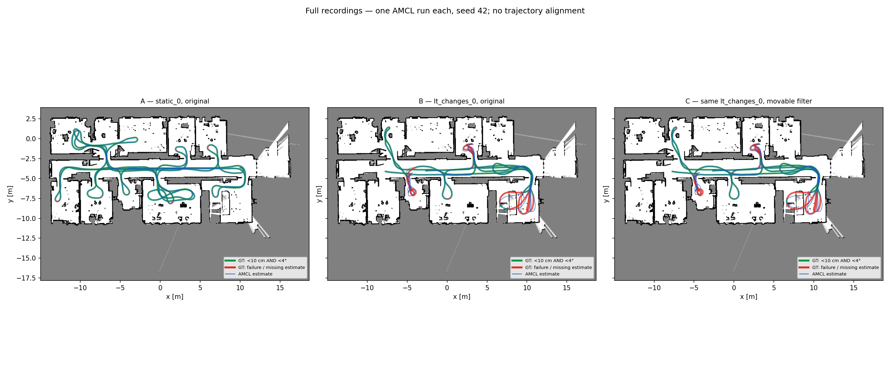

# Celotni vožnji LILocBench: AMCL A / B / C

En celoten zagon A (`static_0`, original), B (`lt_changes_0`, original) in C (isti skeni kot B, filter `movable`). Iste nastavitve pilota, seme 42; brez glasovanja, tuninga ali poravnave trajektorij.



Prikazan je celoten poznani uradni zemljevid z vsemi trajektorijami; odrezan je samo neznani rob slike. Zelena/rdeča GT pot kaže skupni uspeh/neuspeh; modra je ocena AMCL.

## Celotni vožnji

| Zagon | Vsi skeni | Ocenljive poze | Položaj <10 cm [%] | Yaw <4° [%] | Oba praga [%] | Uspešne poze | RMSE [cm / °] | Manjkajoče ocene | Brez GT |
|---|---:|---:|---:|---:|---:|---:|---:|---:|---:|
| A | 8982 | 8976 | 99.87 | 97.64 | 97.64 | 8764 | 3.351 / 1.801 | 12 | 6 |
| B | 6540 | 6534 | 71.87 | 79.03 | 68.56 | 4480 | 18.215 / 6.471 | 16 | 6 |
| C | 6540 | 6534 | 72.79 | 78.51 | 68.69 | 4488 | 18.517 / 6.518 | 16 | 6 |

| Primerjava | Položaj <10 cm [odst. točke] | Yaw <4° [odst. točke] | Oba praga [odst. točke] |
|---|---:|---:|---:|
| **C–B: celotna vožnja, učinek filtra** | +0.92 | -0.52 | +0.12 |

## C–A samo na skupno obiskanih območjih

Pred zagoni je iz GT določen presek 107 celic velikosti 0.5 m. V obeh vožnjah se ocenjujejo samo GT poze v tem preseku. Poti in časovne porazdelitve ostajajo različne, zato je C–A približna opisna referenca.

| Zagon, skupne celice | Ocenljive | Položaj <10 cm [%] | Yaw <4° [%] | Oba praga [%] | RMSE [cm / °] |
|---|---:|---:|---:|---:|---:|
| A | 4659 | 99.74 | 98.82 | 98.82 | 3.467 / 1.563 |
| C | 4388 | 77.28 | 81.93 | 74.36 | 19.549 / 7.495 |

| Primerjava | Položaj <10 cm [odst. točke] | Yaw <4° [odst. točke] | Oba praga [odst. točke] |
|---|---:|---:|---:|
| **C–A: samo skupne celice** | -22.46 | -16.89 | -24.46 |

## Pokritost in lokalni cache

Izbranih je 436 RGB slik pri približno 1 Hz: ponovno uporabljenih 47, lokalno na novo obdelanih 389. Veljavno klasifikacijo in segmentacijo ima 399 izbranih slik.
Časovno veljavno masko ima **601/6540 skenov (9.19 %)**. Filter odstrani 27378 zadetkov (0.518 % vseh veljavnih zadetkov; 5.64 % na skenih z masko).
C uporablja najbližjo posamezno RGB sliko v pilotnem oknu ±50 ms od sredine skena, obstoječo projekcijo s kalibracijo in kompenzacijo z odometrijo. Maske niso razširjene na celoten sekundni interval. Zunaj veljavne povezave, vidnega polja ali pri `uncertain/fixed` ostanejo meritve. Odstranjeni zadetki so NaN. Vsi skeni ostanejo v zaporedju.

Neveljavni ali kontekstno preskočeni Florence/LLM izhodi se ne ponavljajo in ne štejejo kot veljavna maska. Nastavitve modelov/prompti niso spremenjeni. SAM je isti SAM 2.1 Hiera Small. Podatki, uteži, maske, surovi odgovori in veliki izhodi ostajajo lokalno.

## Primerjava s tabelo III

| Zagon | Naš položaj <10 cm [%] | Članek AMCL [%] | Naš yaw <4° [%] | Članek AMCL [%] |
|---|---:|---:|---:|---:|
| A | 99.87 | 100.00 | 97.64 | 96.78 |
| B | 71.87 | 82.89 | 79.03 | 84.01 |
| C | 72.79 | 82.89 | 78.51 | 84.01 |

Članek: statična sekvenca 100,00 ± 0 % in 96,78 ± 0,20 %; dolgoročne spremembe 82,89 ± 0,79 % in 84,01 ± 0,85 %. Za C je ista nefiltrirana AMCL vrstica članka samo referenca, članek našega filtra ne testira.
To ni neposredna reprodukcija tabele III: članek poroča povprečje desetih zagonov; tu je en zagon ROS2 AMCL 1.3.12 s pilotnimi nastavitvami. Ocenjujemo na časih vseh skenov, z manjkajočo oceno kot neuspehom. Ločenih deležev iz članka ni mogoče enačiti z njunim skupnim AND deležem.

## Ponovitev

```bash
python3 -m llm_object_classifier.localization_full --config configs/lilocbench-full.json
```

Ukaz ponovno uporabi cache in že zaključene zagone. Za sveže enkratne A/B/C uporabi novo izhodno mapo v kopiji konfiguracije; lokalni RGB/inferenčni/segmentacijski cache se ohrani. Posamezni koraki: `--stage prepare`, `rgb`, `infer`, `filter`, `A`, `B`, `C`, `report`.
Preverjeno z 41 regresijskimi testi. Prva časovno ustrezna GT poza inicializira vsako vožnjo; A začne en sken pred prvo interpolabilno GT pozo. B/C imata isto inicializacijo in odometrijo. Poznejši GT se uporablja samo za ocenjevanje, skupno prostorsko območje in prikaz. Na robovih posnetkov je za nekaj skenov uporabljena najbližja odometrija največ 150 ms stran; GT se ne ekstrapolira.

[Konfiguracija](../../configs/lilocbench-full.json), [metrike](metrics.json), [vnaprej določen protokol in skupne celice](protocol.json). Lokalno: `results/lilocbench-full/poses.csv`, `protocol.json`, `provenance.json`, dnevniki A/B/C in `data/lilocbench-full/` za cache.

Viri: [LILocBench, podatki in uradni zemljevid](https://www.ipb.uni-bonn.de/html/projects/localization_benchmark/), [članek, tabela III](https://www.ipb.uni-bonn.de/wp-content/papercite-data/pdf/trekel2025iros.pdf), [uradni evaluator](https://github.com/PRBonn/LILocBench). Zemljevid: Trekel et al. (2025), [CC BY-NC-SA 4.0](https://creativecommons.org/licenses/by-nc-sa/4.0/); sestavljena slika pod isto licenco.
