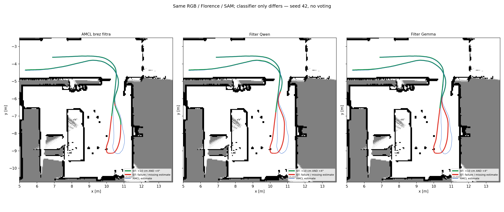

# Qwen / Gemma: spodnja desna soba in prihod po hodniku

Odsek `lt_changes_0`: **1733414160–1733414211**, 765 skenov in 51 istih RGB slik. Izbran na podlagi GT poti pred klasifikacijo Gemma in novimi AMCL zagoni.

Gemma **`gemma3:27b-it-q4_K_M`**, digest `6be2e2ba6843b9255820e2de2cbbe75cfdef0294ac7a531572e654d6e0eefe7d`; Qwen `qwen3.5:27b-q4_K_M`. Gemma nadomesti **samo klasifikacijo** `fixed/movable/uncertain`. Isti zamrznjeni Florence JSON in bajtno enaki sistemski/uporabniški prompti; ista JSON shema, RGB, skupine regij, izvorni ID-ji in originalne SAM maske. Brez glasovanja.



| Različica | Položaj <10 cm [%] | Yaw <4° [%] | Oba praga [%] | Uspešne / ocenljive | RMSE [cm / °] | Pokritost mask [%] | Odstranjeni zadetki |
|---|---:|---:|---:|---:|---:|---:|---:|
| AMCL brez filtra | 74.64 | 74.77 | 74.12 | 567/765 | 15.535 / 4.386 | 0.00 | 0 |
| Qwen | 64.84 | 71.90 | 64.18 | 491/765 | 16.840 / 4.771 | 7.06 | 1440 |
| Gemma | 66.14 | 70.59 | 64.44 | 493/765 | 16.170 / 4.695 | 6.93 | 1441 |

Veljavne klasifikacije slik: Qwen 47/51, Gemma 47/51. Različnih razredov je 109/570 primerljivih izvornih regij. Neveljaven/preskočen odgovor ohrani sken; ničesar ne popravljamo ali krajšamo. Razlika v pokritosti je posledica veljavnosti klasifikacij, ne različnih mask.

Vsi trije AMCL zagoni so sveži na istem odseku: ista prva GT inicializacija in kovarianca, odometrija, časovni koraki, nastavitve pilota in seme 42. Prejšnje celozaporedne poze niso izrezane kot nadomestilo za nov zagon. Poznejši GT samo ocenjuje in riše, brez poravnave trajektorij.
Ocena AMCL je modra; GT je zelen samo pri hkratnih napakah <10 cm in <4°, drugod rdeč. Isti izrez in merilo v vseh panelih. Filter obdrži vse skene in uporablja samo posamezno RGB masko v oknu ±50 ms; odstranjeni zadetki so NaN.

Ponovno uporabljene so vse Florence/RGB/SAM datoteke; novih Florence/SAM klicev ni. Veljavnih starih podpisanih Gemma odgovorov je ponovno uporabljenih 4. Surovi izpisi in predogledi ostanejo lokalno: `results/lilocbench-qwen-gemma/previews`.

```bash
python3 -m llm_object_classifier.localization_qwen_gemma --config configs/lilocbench-qwen-gemma.json
```

[Konfiguracija](../../configs/lilocbench-qwen-gemma.json), [metrike in neveljavni odgovori](metrics.json). Zemljevid: [LILocBench, Trekel et al.](https://www.ipb.uni-bonn.de/html/projects/localization_benchmark/), [CC BY-NC-SA 4.0](https://creativecommons.org/licenses/by-nc-sa/4.0/); sestavljena slika pod isto licenco.
