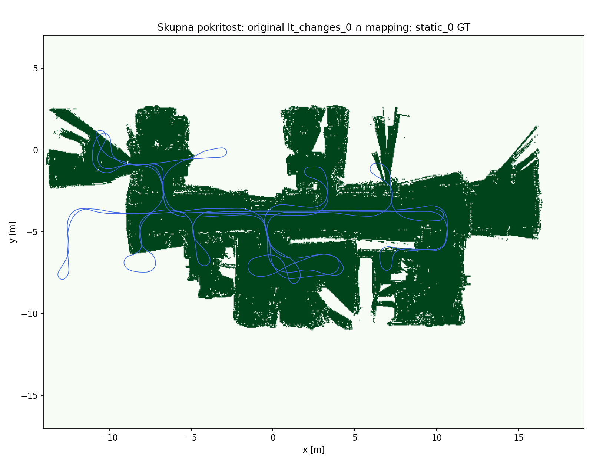
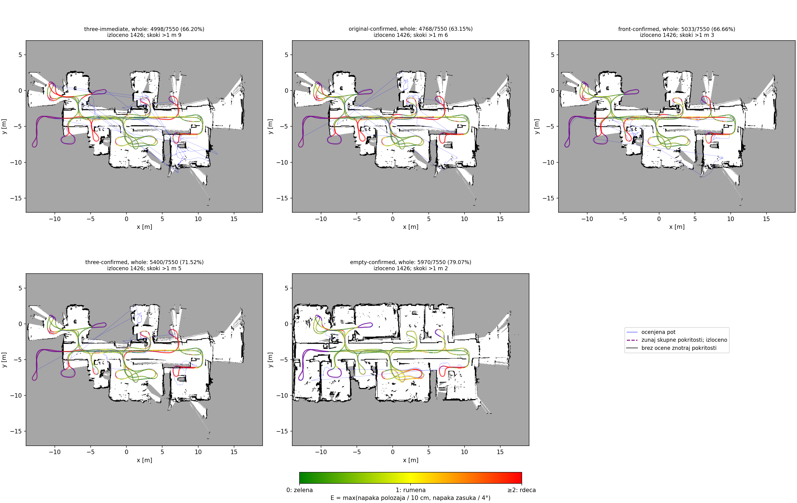
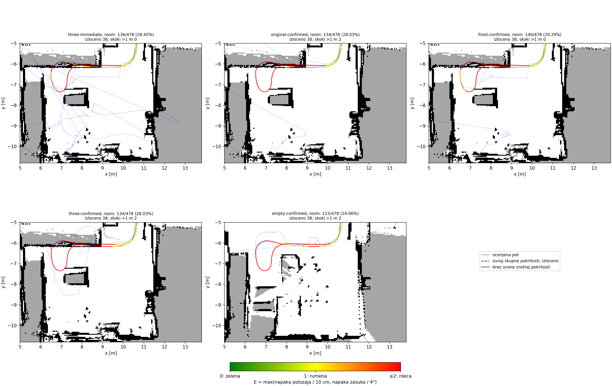

# Potrjevanje oddaljenih globalnih poz

Pokritost je **pred lokalizacijo** zamrznjena kot presek znanih 5 cm celic (occupancy != −1) iz nefiltriranega `lt_changes_0` in neodvisnega `mapping`, brez dilatacije. Ista maska velja za vseh pet primerjav. Glavna tabela in zaključek uporabljata samo **7550** GT poz v maski; **1426** nezmapiranih GT poz je izločenih, dodatnih **6** skenov nima GT. Vseeno vsak lokalizator neprekinjeno predvaja vseh 8982 skenov; ob vstopu na pokrito območje ni resetiranja. GT in maska nikoli nista vhod algoritma.

Osnova je sekvenčni matcher iz `0510c225`. Oddaljeno pomeni predlog >1 m ali >15° od trenutne odometrijske napovedi; tudi neznana začetna poza zahteva potrditev. Predlog sprejmemo šele po petih zaporednih LiDAR podporah (vsaj 0,20 s). Vmes kandidat sledi izključno relativni kolesni odometriji, lokalni LiDAR fit pa mora ostati znotraj 12 cm in 4° te verige. Lokalni in globalni pragovi kakovosti so enaki predhodnemu preizkusu. Slaba ali dvoumna podpora predlog zavrne. Bližnji globalni predlogi ne potrebujejo dodatne potrditve.

Do potrditve objavljamo prejšnjo odometrijsko napoved kot negotovo, ne oddaljenega predloga; pri neznanem začetku ocene še ni. Pet zaporednih podpor ne zagotavlja pravilnosti v geometrijsko podobnih prostorih. Po potrditvi sledimo z istim lokalnim matcherjem; pri izgubi se ponovno išče globalno. Vsi potrjeni primeri uporabljajo enako konfiguracijo in kolesno odometrijo. Florence, Qwen, Gemma, SAM in AMCL se ne zaganjajo; mreže niso ponovno zgrajene.

Primer `three-immediate` ponovno uporablja preverjen celotni predhodni zagon iste kode, nastavitev, mreže in skenov. Njegovi hashi so preverjeni pred primerjavo. `three-confirmed` je izračunan enkrat ter uporabljen v obeh primerjavah; ostali trije potrjeni zemljevidi se izračunajo enkrat. Ni izbora boljšega semena ali ponavljanja zaradi rezultatov.

Uspeh je geometrijska napaka položaja <10 cm in zasuka <4°, tudi če je odometrijska napoved označena kot negotova. Sekundarni `confident_n` zahteva še nenegotovo oceno. Manjkajoče ocene pri GT so neuspeh; P95 veljajo za razpoložljive ocene. Skok >1 m je razlika dveh sosednjih ocen, pri katerih sta obe GT pozi v isti skupni maski. Dogodki izven pokritosti so v CSV, ne v glavni tabeli. Zakasnitev potrditve je čas posnetka od predloga do sprejema; v tabeli štejejo dogodki, končani v maski in navedenem območju. Čas prve pravilne poze se meri od začetka celotnega posnetka, ne od vstopa v masko.

| Primer / območje | Uspeh n/N (%) | P95 položaj [cm] | P95 zasuk [°] | Skoki >1 m | Potrditev med/P95 [s] | Izločeno |
|---|---:|---:|---:|---:|---:|---:|
| three-immediate / whole | 4998/7550 (66.20) | 768.17 | 176.89 | 9 | —/— | 1426 |
| three-immediate / room | 136/478 (28.45) | 59.81 | 8.87 | 0 | —/— | 38 |
| original-confirmed / whole | 4768/7550 (63.15) | 558.62 | 82.95 | 6 | 0.27/0.27 | 1426 |
| original-confirmed / room | 134/478 (28.03) | 729.99 | 95.96 | 2 | 0.27/0.27 | 38 |
| front-confirmed / whole | 5033/7550 (66.66) | 97.23 | 8.98 | 3 | 0.27/0.27 | 1426 |
| front-confirmed / room | 140/478 (29.29) | 62.71 | 10.83 | 0 | 0.27/0.27 | 38 |
| three-confirmed / whole | 5400/7550 (71.52) | 309.84 | 8.27 | 5 | 0.27/0.27 | 1426 |
| three-confirmed / room | 134/478 (28.03) | 258.28 | 108.54 | 2 | 0.27/0.27 | 38 |
| empty-confirmed / whole | 5970/7550 (79.07) | 46.29 | 4.75 | 2 | 0.27/0.27 | 1426 |
| empty-confirmed / room | 115/478 (24.06) | 2055.96 | 176.63 | 2 | 0.27/0.27 | 38 |

Na **skupno pokritih pozah** potrjevanje spremeni uspešnost treh kamer za +5.32 odstotne točke in število skokov >1 m iz 9 na 5. To je en parni preizkus; zaključek se ne nanaša na nezmapirane odseke.





Zelena E=0, rumena E=1, rdeča E≥2; siva pomeni manjkajočo oceno znotraj pokritosti. Vijolično črtkano je izven skupne pokritosti in izločeno iz glavnih metrik. Tanka modra je celotna ocenjena pot. Barva segmenta uporablja največji E obeh koncev.

[Poze](poses.csv) · [Povzetek](summary.csv) · [Predlogi in potrditve](confirmation-events.csv) · [Pokritost po skenih](scan-coverage.csv) · [Natančna maska PNG](coverage-mask.png) · [Vnaprej zamrznjeni protokol](protocol.json) · [Preverjanje](validation.json).

## Ponovitev

```bash
OPENBLAS_NUM_THREADS=1 MPLCONFIGDIR=/tmp/mpl-lilocbench python3 maintenance/run_confirmed_relocalization.py --stage smoke
OPENBLAS_NUM_THREADS=1 MPLCONFIGDIR=/tmp/mpl-lilocbench python3 maintenance/run_confirmed_relocalization.py --stage full
OPENBLAS_NUM_THREADS=1 python3 maintenance/validate_relocalization.py
```

Potrebuje obstoječe `static_0/raw.npz`, `raw.json`, uradno kalibracijo ter štiri `results/lilocbench-reverse/maps/*/occupancy.npy`. Za ponovno uporabo takojšnjega načina sta potrebna predhodni `data/lilocbench-tracking/full/three-wheel_odometry.csv` in revizija `full-validation.json`. Ostala začasna polja/CSV ostanejo v lokalnem `data/lilocbench-relocalization`. Za nov izračun uporabi drugo izhodno mapo v konfiguraciji. Podatki: LILocBench, Trekel et al., IROS 2025, CC BY-NC-SA 4.0.

Podrobnejši sklep na isti maski: v sobi potrjevanje treh kamer spremeni uspeh 136/478 → 134/478, P95 položaja 59.81 → 258.28 cm in P95 zasuka 8.87 → 108.54°. Zmanjšanje skokov na celotni pokriti poti torej ne pomeni izboljšanja sobe. Tri potrjene kamere glede na sprednjo dosežejo +4.86 odstotne točke več uspeha, vendar slabši P95 položaja (309.84 proti 97.23 cm).
