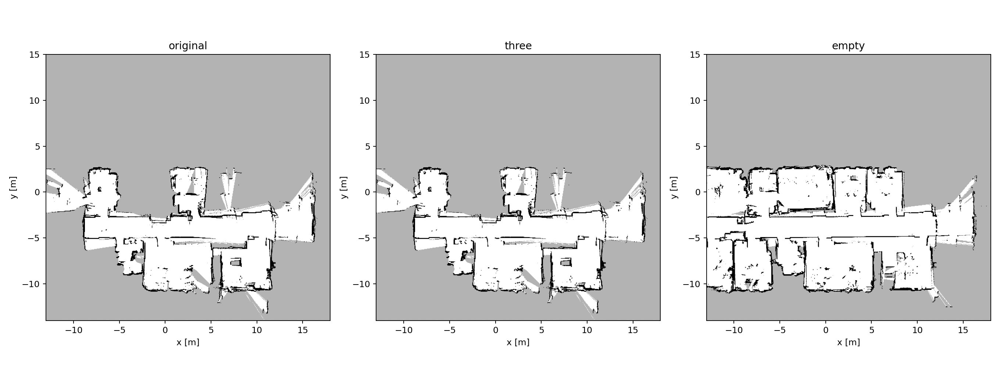
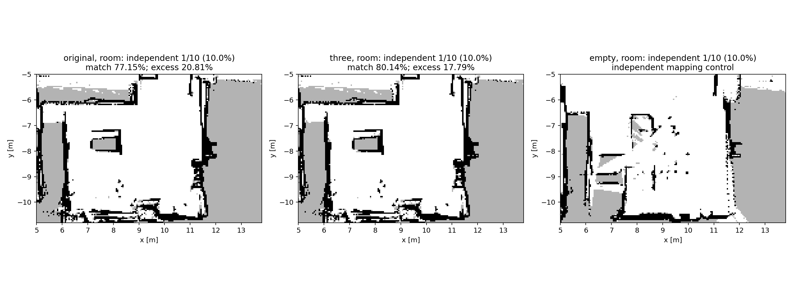
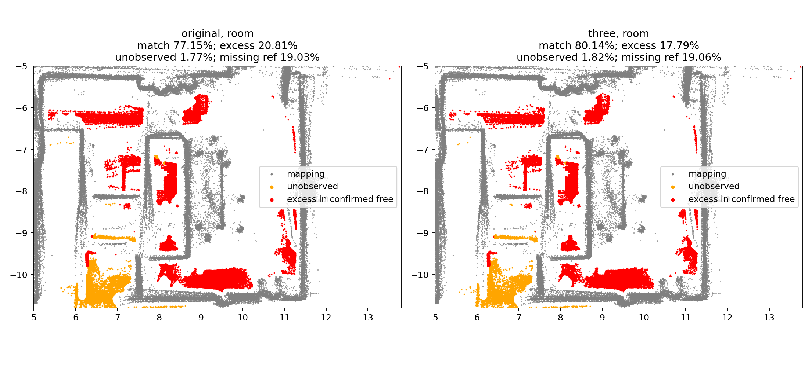
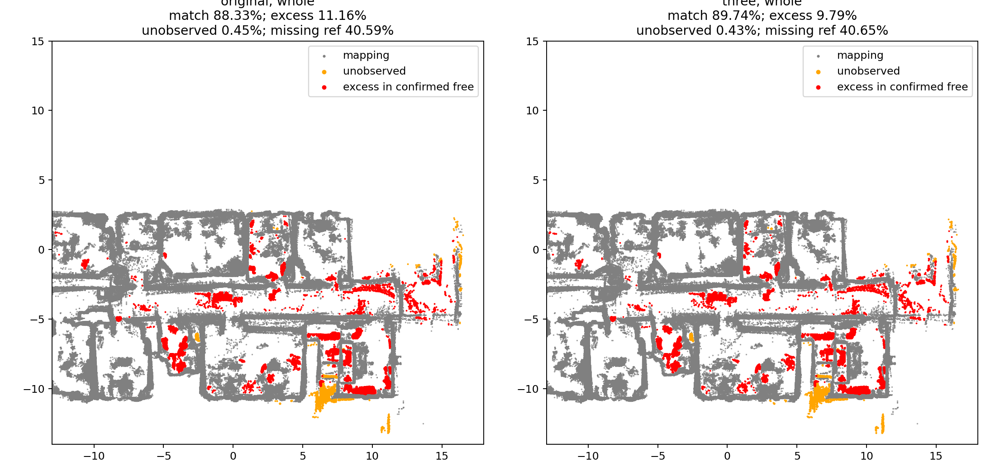
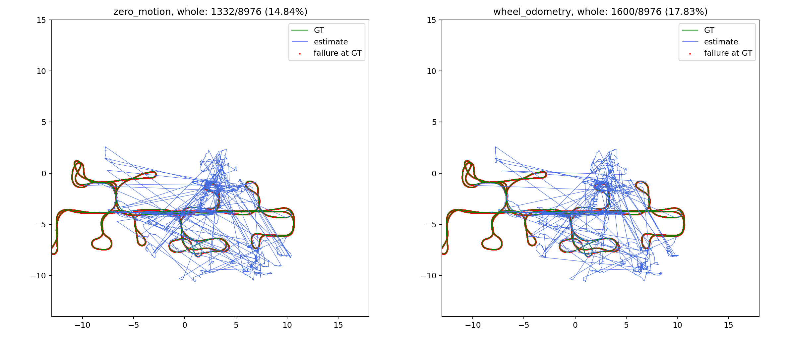
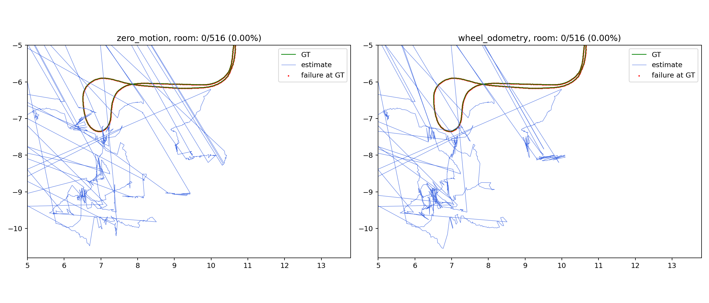

# LILocBench: kratek obratni preizkus

Seme **42**. `lt_changes_0`: gradnja z dodanimi/prestavljenimi predmeti; `mapping`: neodvisno osnovno stanje z običajnim pohištvom; `static_0`: samo testna vožnja. Brez poravnave na testni GT.

Neodvisno ocenjenih 32 poz: 24 enakomernih vzorcev po dolžini celotne poti in 8 po poti v sobi, po odstranitvi podvojitev. Časovne oznake: [selected-poses.csv](selected-poses.csv). Izbor je zamrznjen pred lokalizacijo. GT služi izboru vzorcev in oceni; ne inicializaciji ali izbiri kandidata.

Algoritem posameznega skena: izčrpno grobo ujemanje SE(2) z likelihood field in lokalno optimizacijo 24 ločenih hipotez. Začetni položaji: proste celice kontrolnega zemljevida na mreži 0,4 m; orientacije −π do π po 5°. Isto dovoljeno območje, kandidati in proračun na vseh zemljevidih. 96 grobih in do 400 finih žarkov, največ 35 evalvacij optimizatorja na hipotezo. Semantičnega filtriranja testnih skenov ni. Lokalizacija nima kompenzacije gibanja znotraj skena.

Sekvenčni algoritem: filter 2048 delcev z istim globalnim začetnim iskanjem, likelihood field, sistematičnim prevzorčenjem in lokalno optimizacijo. Oba načina uporabljata vse testne skene, enako seme, šum in nastavitve. 40 globalnih delcev na sken omogoča ponovno lokalizacijo. Ni AMCL. `zero_motion` vrne ničelne premike pred izračunom razlik odometrije; izmerjene premike uporablja samo `wheel_odometry`. Revizija: [motion-audit.json](motion-audit.json).

Uspeh: položaj <10 cm **in** orientacija <4°. Manjkajoča ocena pri veljavnem GT je neuspeh; manjkajoč GT je izločen in preštet. Čas je stenski čas CPU lokalizacije posameznega skena (predpriprava polja in pretvorba žarkov izključeni); prvi sken vključuje globalno iskanje. Čas do prvega uspeha pomeni čas na posnetku od prvega skena; posebej je naveden seštevek časa računanja. Prvi uspeh ni dokaz trajne konvergence.

## Geometrija proti mapping

| Različica / območje | Točke | Ujemanje n (%) | Odvečne v prostem n (%) | Neopažene n (%) | Drugo opaženo n (%) | Manjkajoča ref. n (%) |
|---|---:|---:|---:|---:|---:|---:|
| original / whole | 5278495 | 4662608 (88.33) | 589326 (11.16) | 23798 (0.45) | 2763 (0.05) | 3970776 (40.59) |
| original / room | 974013 | 751467 (77.15) | 202679 (20.81) | 17205 (1.77) | 2662 (0.27) | 197667 (19.03) |
| three / whole | 4967857 | 4458100 (89.74) | 486280 (9.79) | 21319 (0.43) | 2158 (0.04) | 3976729 (40.65) |
| three / room | 840801 | 673835 (80.14) | 149563 (17.79) | 15342 (1.82) | 2061 (0.25) | 198005 (19.06) |

Toleranca 10 cm v skupnem koordinatnem sistemu. Imenovalec so ohranjeni zvezni GT-kompenzirani LiDAR zadetki, brez voxel deduplikacije. Odvečno zahteva prosto celico v `mapping`; neopaženo je ločeno. Sekundarno manjkajoča referenca ima imenovalec referenčne zadetke. Območje sobe: [5.0, -10.8, 13.8, -5.0].

Veljavno masko vsaj ene kamere je imelo **1749723** zadetkov od **5282883**; združevanje je odstranilo **311199**. Po odstranitvi je izpuščen celoten žarek, zato za odstranjenim predmetom ne nastane prosti prostor. Obe različici uporabljata iste poze in mrežo. [Prispevki kamer](camera-audit.json).

## Lokalizacija in čas

| Način / različica / območje | Uspeh n/N (%) | Mediana [s] | P95 [s] | Prvi uspeh [s posnetka / št. skenov] |
|---|---:|---:|---:|---|
| independent / original / whole | 13/32 (40.62) | 0.2368 | 0.2551 | 0.067 / — |
| independent / original / room | 1/10 (10.00) | 0.2288 | 0.2382 | 269.999 / — |
| independent / three / whole | 13/32 (40.62) | 0.2483 | 0.2736 | 0.067 / — |
| independent / three / room | 1/10 (10.00) | 0.2467 | 0.2545 | 269.999 / — |
| independent / empty / whole | 18/32 (56.25) | 0.2440 | 0.2594 | 0.067 / — |
| independent / empty / room | 1/10 (10.00) | 0.2433 | 0.2495 | 269.999 / — |
| sequential / zero_motion / whole | 1332/8976 (14.84) | 0.0045 | 0.0061 | 0.067 / 2 |
| sequential / zero_motion / room | 0/516 (0.00) | 0.0045 | 0.0059 | ni pravilne ocene |
| sequential / wheel_odometry / whole | 1600/8976 (17.83) | 0.0045 | 0.0062 | 0.067 / 2 |
| sequential / wheel_odometry / room | 0/516 (0.00) | 0.0045 | 0.0060 | ni pravilne ocene |

Izmerjena odometrija je spremenila delež uspešnih poz za **+2.99 odstotne točke** na celotni poti. To je parna primerjava enega semena; iz nje ne ocenjujemo statistične zanesljivosti.








Podatki: [meritve po pozah](poses.csv), [geometrija](geometry.csv), [lokalizacija in čas](localization.csv), [protokol in hashi](protocol.json), [preverjanje](validation.json).

Ponovitev iz korena repozitorija (ob obstoječih pripravljenih podatkih, maskah in zemljevidih iz poskusa `86f7c57`):

```bash
MPLCONFIGDIR=/tmp/mpl-lilocbench OPENBLAS_NUM_THREADS=1 python3 maintenance/run_reverse_short.py
MPLCONFIGDIR=/tmp/mpl-lilocbench OPENBLAS_NUM_THREADS=1 python3 maintenance/check_reverse_short.py
```

Vhodni zemljevidi: `results/lilocbench-reverse/maps/{original,three,empty}`; pripravljeni skeni: `data/lilocbench-filtered-map/{lt_changes_0,mapping,static_0}/raw.npz`; projekcije in maske: `data/lilocbench-reverse`. Izračun ne kliče modelov in ne spreminja starega poročila. Podatki LILocBench: Trekel et al., IROS 2025, CC BY-NC-SA 4.0.

Dodatno preverjanje: [ponovna gradnja zemljevidov](map-rebuild-validation.json) in [časovna uskladitev, kalibracije ter enakost skenov](input-audit.json). Drugi ukaz sveže zgradi vse tri zemljevide, preveri ujemanje in izvozi prenosno poročilo v `docs/lilocbench-reverse-short`.

Vpliv odometrije: na celotni poti je pomagala (1332/8976 proti 1600/8976); v sobi ni pomagala (0/516 proti 0/516). Oba načina prvič dosežeta pravilno oceno pri skenu 2, po 0.067 s posnetka.
