# Kako dobro deluje semantično filtriranje LiDAR?

**Zaključen preizkus LILocBench, 18. november 2026.** Ta pregled najprej obravnava običajni AMCL brez dodatne odometrijske premostitve in brez umetnih izpadov. AMCL v teh rezultatih **še vedno uporablja kolesno odometrijo**. Lokalizacija povsem brez odometrije ni bila preizkušena.

[PDF za branje in deljenje](porocilo.pdf) · [Vseh 280 rezultatov](data/metrics.json) · [Ponovitev in metoda](../lilocbench-reverse.md) · [Odometrijska premostitev, ločen dodatek](odometrija.md)

## Kratek odgovor

- **Zanesljivega izboljšanja lokalizacije še ni.** Tri kamere v obratnem testu dosežejo 45,25 % skupnega uspeha, brez filtra 43,71 %. Parna razlika je +1,54 ± 20,75 odstotne točke; med semeni se učinek močno spreminja.
- **Referenčno osnovno stanje je bistveno boljše:** isti static_0 skeni na neodvisnem mapping zemljevidu dosežejo 89,40 % skupnega uspeha. Ta kontrola se razlikuje tudi v prostorski pokritosti in postavitvi pohištva, zato celotne razlike ne pripisujemo samo filtru.
- **Geometrija se delno izboljša:** v problematični sobi delež ujemanj naraste 74,59 → 77,90 %, delež odvečnih točk v potrjeno prostem prostoru pade 19,28 → 16,67 %. To sta metriki točk, ne uspešnost lokalizacijskih poz.

## Kaj pomeni »z ovirami« in »brez ovir«

`lt_changes_0` prikazuje dodano škatlo in prestavljeno pohištvo. `static_0` in neodvisni `mapping` prikazujeta osnovno stanje, ki še vsebuje običajno pohištvo. **Popolnoma prazne sobe oziroma nadzorovanega para pred/po odstranitvi vseh premičnih predmetov v teh podatkih nismo potrdili.** Zato spodaj uporabljamo izraz »referenčno osnovno stanje«, ne »zemljevid brez vseh ovir«.

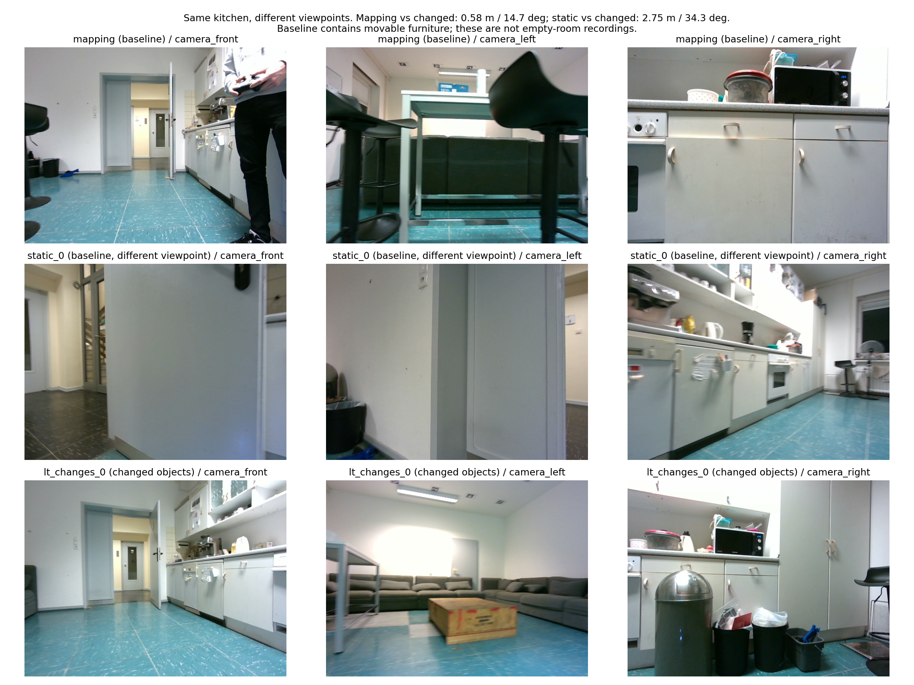

Pogledi med vožnjami niso povsem isti: primer static_0 je bližje vratom. Vse vožnje so v skupnem javnem koordinatnem sistemu; trajektorij dodatno ne poravnavamo.

## 1. Zemljevidi in vidne spremembe

Prvi trije zemljevidi nastanejo iz iste celotne lt_changes_0 vožnje, z istimi GT pozami in isto mrežo 5 cm. Razlikuje se samo filter zadetkov. Četrti je neodvisni osnovni mapping. Odstranjeni žarek ne posodobi niti zasedenosti niti prostega prostora.

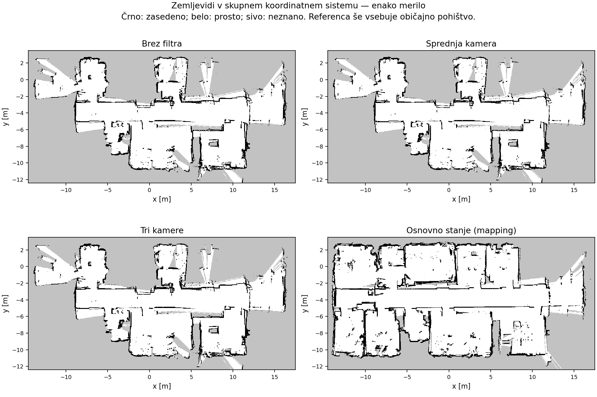
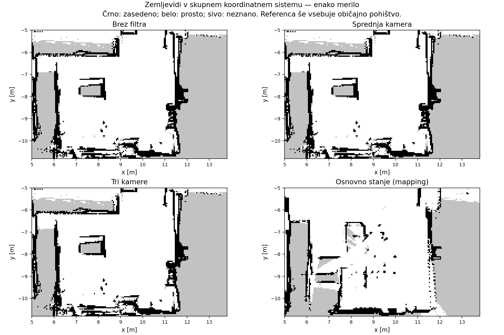
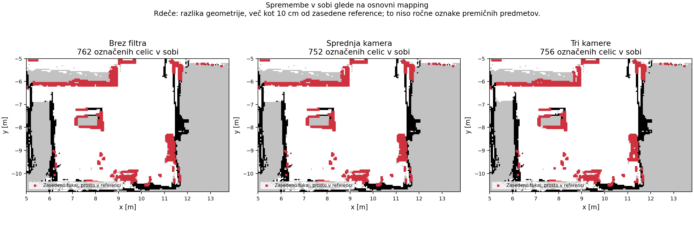

Rdeče označene celice so zasedene v spremenjenem zemljevidu, proste v mapping in več kot 10 cm od njegove zasedene geometrije. To je dodatni rastrski prikaz razlik; ni ročna oznaka premičnega predmeta in ni ista metrika kot primerjava koncev žarkov proti static_0.

**Ovire v zemljevidu večinoma ostanejo.** Brez filtra je zasedenih 10.028 celic, s tremi kamerami 10.000. Tri kamere razvrstijo 262 prvotno zasedenih celic drugače, hkrati pa je 234 drugih celic na novo zasedenih. V sobi se število rdeče označenih odstopanj glede na mapping spremeni 762 → 756. To ni uspešna odstranitev vseh ovir, čeprav se metrike posameznih ohranjenih točk izboljšajo.

## 2. Lokalizacija brez dodatne odometrijske premostitve

Vsi deleži spodaj so povprečje ± populacijski standardni odklon desetih semen 42–51. Skupni uspeh zahteva **položaj <10 cm IN orientacijo <4°**. Manjkajoča ocena ob veljavnem GT šteje kot neuspeh.

### A. Obratni test: spremenjen zemljevid → originalni static_0 skeni

Skenov za lokalizacijo tukaj ne filtriramo. Vsak zemljevid dobi identične skene, odometrijo, inicializacijo in parna semena.

| Zemljevid | Položaj <10 cm [%] | Orientacija <4° [%] | Oba [%] | RMSE položaja [cm] |
|---|---:|---:|---:|---:|
| Brez filtra | 46.49 ± 15.47 | 65.43 ± 16.65 | 43.71 ± 14.34 | 212.67 ± 308.10 |
| Sprednja kamera | 44.37 ± 15.67 | 65.05 ± 13.23 | 41.89 ± 14.55 | 155.79 ± 143.08 |
| Tri kamere | 47.83 ± 11.70 | 68.38 ± 8.46 | 45.25 ± 11.18 | 126.92 ± 61.52 |
| Osnovno stanje (mapping) | 93.21 ± 0.35 | 95.24 ± 0.50 | 89.40 ± 0.56 | 6.32 ± 0.33 |

Velik RMSE in velik raztros v prvih treh vrsticah pomenita, da nekateri zagoni izgubijo lokalizacijo. Prikazano seme 42 je bilo določeno pred rezultati in ni povprečna trajektorija.

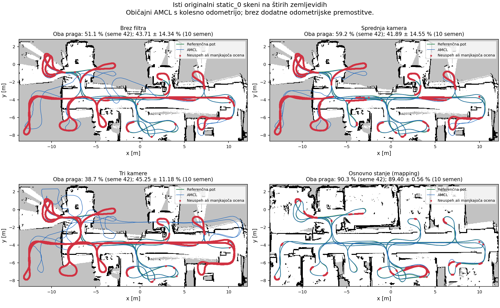
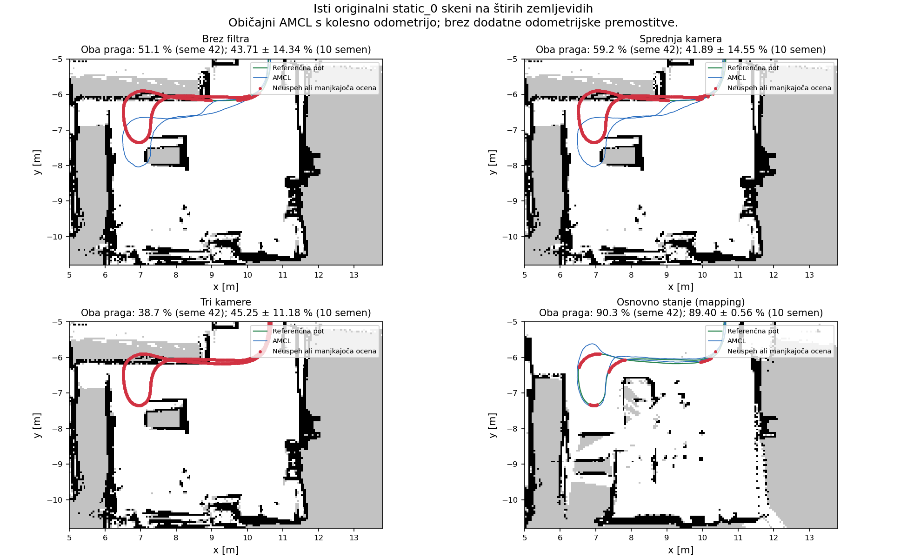

### B. Isti osnovni mapping → različno filtrirani lt_changes_0 skeni

Zemljevid je v vseh treh vrsticah enak. Filtriranje poteka samo na lokalizacijskih skenih.

| Filter skenov | Položaj <10 cm [%] | Orientacija <4° [%] | Oba [%] | RMSE položaja [cm] |
|---|---:|---:|---:|---:|
| Brez filtra | 66.20 ± 0.93 | 74.60 ± 1.52 | 62.19 ± 1.16 | 23.12 ± 2.51 |
| Sprednja kamera | 66.45 ± 1.18 | 74.21 ± 1.33 | 62.57 ± 1.02 | 23.38 ± 1.96 |
| Tri kamere | 65.41 ± 2.72 | 78.73 ± 1.32 | 61.87 ± 2.73 | 22.77 ± 6.13 |

Tri kamere izboljšajo ločeni delež pravilne orientacije, skupni uspeh pa ostane približno enak oziroma nekoliko nižji.

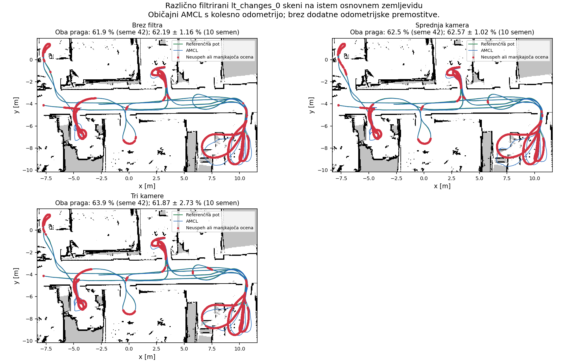
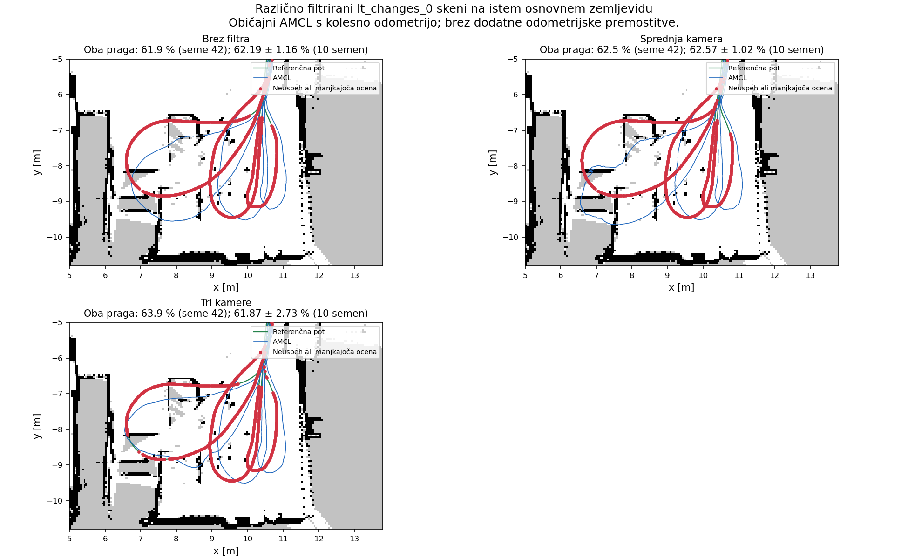

Na poteh je zeleno referenčna trajektorija, modro AMCL in rdeče neuspešen odsek na referenčni poti, tudi kadar ocena manjka. V celotnem prikazu ni odrezana nobena veljavna referenčna ali ocenjena poza.

### Parna primerjava in ponovitve

| Test | Sprednja − brez filtra [odst. točke] | Tri − brez filtra [odst. točke] |
|---|---:|---:|
| A: obratni test | -1.82 ± 16.55 | 1.54 ± 20.75 |
| B: filtriranje skenov | 0.38 ± 1.56 | -0.32 ± 2.74 |

Odklon je izračunan na razlikah istega semena, ne iz razlike dveh odklonov. Rezultati ne kažejo dosledne prednosti treh kamer pri lokalizaciji.

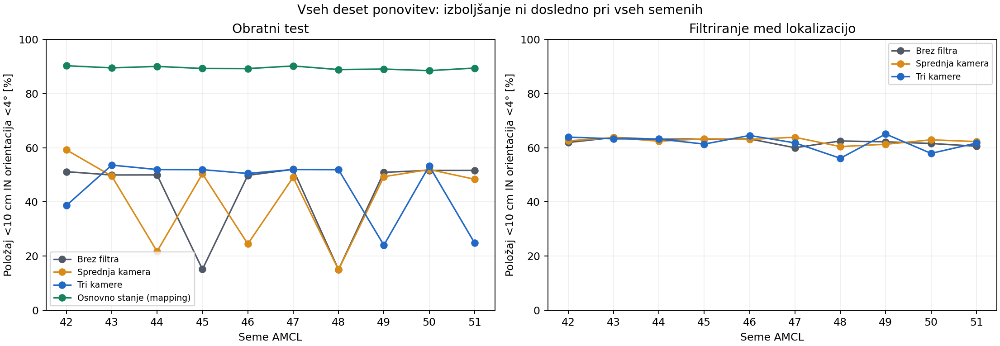

### Posebej: lokalizacija v problematični sobi

To je izrez že ocenjene celotne trajektorije, brez nove inicializacije. A uporablja 516 veljavnih GT vzorcev static_0 v sobi, B pa 1.224 vzorcev lt_changes_0. Zato rezultatov A in B ne primerjamo kot identičnih poti.

| Test / filter | Položaj <10 cm [%] | Orientacija <4° [%] | Oba [%] |
|---|---:|---:|---:|
| A / Brez filtra | 20.87 ± 11.34 | 36.86 ± 16.87 | 17.31 ± 9.78 |
| A / Sprednja kamera | 18.66 ± 9.34 | 47.60 ± 7.74 | 16.76 ± 9.22 |
| A / Tri kamere | 22.87 ± 11.51 | 43.99 ± 16.14 | 20.60 ± 10.44 |
| A / Osnovno stanje (mapping) | 81.36 ± 4.11 | 85.99 ± 3.29 | 73.86 ± 3.64 |
| B / Brez filtra | 28.05 ± 2.62 | 56.76 ± 6.54 | 26.79 ± 2.46 |
| B / Sprednja kamera | 28.12 ± 1.53 | 52.83 ± 5.14 | 26.81 ± 1.18 |
| B / Tri kamere | 29.84 ± 2.88 | 73.10 ± 3.45 | 29.26 ± 2.81 |

**V sobi ostaja lokalizacija slaba:** A s tremi kamerami doseže 20,60 % proti 17,31 % brez filtra; neodvisni osnovni zemljevid doseže 73,86 %. Pri B tri kamere dosežejo 29,26 % proti 26,79 % brez filtra. [Metrike sobe za vsa semena](data/room-localization.json).

## 3. Koliko geometrije ostane pravilne

Referenca je celotna static_0 vožnja. Za vsak ohranjen konec žarka preverimo najbližjo referenčno točko z isto toleranco 10 cm. Neujemanje je »odvečno v prostem« samo ob prosti celici referenčne mreže. Neopažena območja ostanejo ločena.

| Območje / filter | Ohranjenih točk | Ujemanje [%] | Odvečno v prostem [%] | Neopaženo [%] | Manjkajoča referenca, sekundarno [%] |
|---|---:|---:|---:|---:|---:|
| Celota / Brez filtra | 5,278,495 | 91.53 | 7.22 | 1.17 | 22.05 |
| Celota / Sprednja kamera | 5,136,836 | 91.93 | 6.86 | 1.12 | 22.06 |
| Celota / Tri kamere | 4,967,857 | 92.69 | 6.27 | 0.97 | 22.09 |
| Soba / Brez filtra | 974,013 | 74.59 | 19.28 | 5.68 | 20.60 |
| Soba / Sprednja kamera | 931,408 | 75.30 | 18.73 | 5.54 | 20.60 |
| Soba / Tri kamere | 840,801 | 77.90 | 16.67 | 5.04 | 20.64 |

Preostanek do 100 % sestavljajo opažene, a neujemajoče se/zasedene ali neodločene celice (0,07–0,45 %). Izboljšanje deleža ujemanj ne pomeni, da so bile odstranjene samo napačne točke: filter odstrani tudi del ujemajočih se zadetkov. Sekundarna metrika manjkajoče reference se rahlo poslabša.

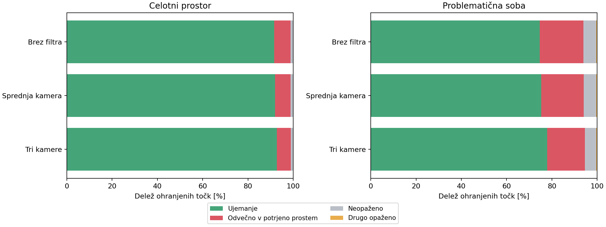
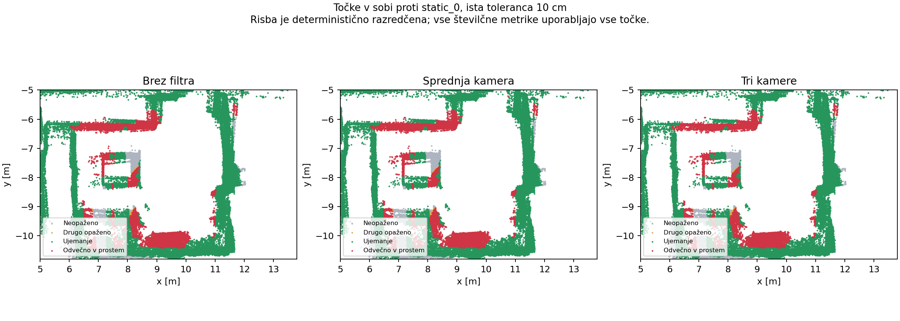

## 4. Kaj dodatno prispevata stranski kameri

- Geometrijsko dodatno pokrijeta **1,909,354** zadetkov.
- Dodatno odstranita **176,344** zadetkov; pri **7,209** preprečita odstranitev sprednje kamere zaradi zaščitnega pravila.
- Sprednja kamera odstrani **142,064**, tri kamere skupaj **311,199** od **5,282,883** veljavnih zadetkov.

Vsak sken uporablja časovno najbližjo veljavno masko posamezne kamere znotraj ±50 ms ter njeno kalibracijo. Odločitve se združijo po indeksu istega LiDAR zadetka. Konfliktne/fixed/uncertain oznake in manjkajoča maska v vidni kameri zaščitijo zadetek. Časovna pokritost je delna, zato lahko nefiltrirani skeni iste objekte še vedno vpišejo v zemljevid. Projekcija ne preverja zakrivanja z globinsko sliko.

## Sklep

Filtriranje s tremi kamerami izboljša ujemanje ohranjene geometrije in zmanjša odvečne točke, posebej v sobi. **Ta izboljšava se v trenutni postavitvi ne pretvori v zanesljivo boljšo lokalizacijo AMCL.** Najboljša kontrola ostaja neodvisni osnovni zemljevid. Potreben je boljši oziroma dejansko prazen referenčni par, preverjanje zakrivanja in stabilnejša pokritost mask; iz teh rezultatov ne sklepamo, da je prostor uspešno očiščen vseh ovir.

## Podatki in ponovljivost

Primarna tabela uporablja 70 zagonov običajnega AMCL brez umetnih vrzeli. Celoten arhiv vsebuje 280 zagonov, tudi primerjave premostitve in umetnih vrzeli. Maske in zemljevidi so za vsa semena zamrznjeni; prikazani odklon meri variabilnost AMCL, ne negotovosti klasifikacije.

- [Vse metrike po zagonih](data/metrics.json), [geometrija](data/geometry.json), [parne razlike](data/paired-effects.json), [protokol](data/protocol.json).
- [Prenosni podatki za risbe](data/plot-data.npz), [sled izvoza](data/publication-provenance.json).
- Ponovni izris iz priloženih podatkov: `python3 maintenance/export_reverse_report.py`. Zbiranje iz lokalnega cache: isti ukaz z `--collect`.
- Nobena inferenca ali AMCL se med izdelavo tega poročila ne zažene.

Vir: Trekel et al., LILocBench, IROS 2025. [Uradni opis podatkov](https://www.ipb.uni-bonn.de/html/projects/localization_benchmark/). Podatki in izpeljani zemljevidi: [CC BY-NC-SA 4.0](https://creativecommons.org/licenses/by-nc-sa/4.0/).
