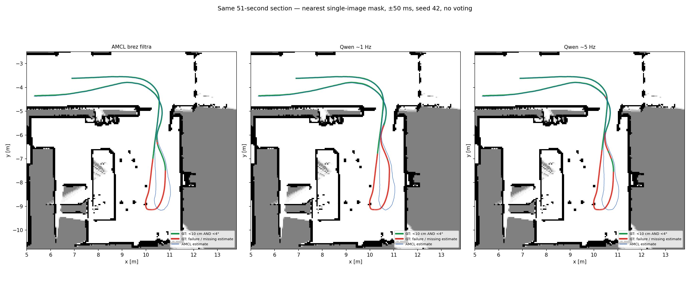

# Qwen: približno 1 Hz proti 5 Hz — isti odsek

Odsek `lt_changes_0`, **1733414160–1733414211**, 765 nespremenjenih skenov. Model `qwen3.5:27b-q4_K_M`, isti Florence/SAM, prompti, projekcija, filter, ±50 ms, začetna poza, odometrija, AMCL parametri in seme 42. Posamezna slika, brez glasovanja in tuninga.



| Območje | Različica | Uspešne / ocenljive | Uspeh [%] | Pokritost skenov z masko [%] | Odstranjeni zadetki |
|---|---|---:|---:|---:|---:|
| Celoten odsek | AMCL brez filtra | 567/765 | 74.12 | 0.00 | 0 |
| Celoten odsek | Qwen ~1 Hz | 491/765 | 64.18 | 7.06 | 1440 |
| Celoten odsek | Qwen ~5 Hz | 519/765 | 67.84 | 34.90 | 7223 |
| Soba | AMCL brez filtra | 167/365 | 45.75 | 0.00 | 0 |
| Soba | Qwen ~1 Hz | 91/365 | 24.93 | 5.75 | 958 |
| Soba | Qwen ~5 Hz | 122/365 | 33.42 | 30.68 | 5022 |
| Hodnik | AMCL brez filtra | 400/400 | 100.00 | 0.00 | 0 |
| Hodnik | Qwen ~1 Hz | 400/400 | 100.00 | 8.25 | 482 |
| Hodnik | Qwen ~5 Hz | 397/400 | 99.25 | 38.75 | 2201 |

**5 Hz minus 1 Hz:** celoten odsek +3.66 odstotne točke; soba +8.49; hodnik -0.75. V primerjavi z nefiltriranim AMCL je razlika pri 5 Hz -6.27 odstotne točke.

Vseh 51 izvirnih slik je ohranjenih. Pri 5 Hz je skupaj 255 slik, dodanih 204; z lokalnim pipelineom je obdelanih le 204 manjkajočih. Stare slike nadomestijo najbližja mesta mreže 0,2 s, zato vzorčenje ni povsem enakomerno. Veljavno klasifikacijo in maske ima 234 slik.
Zaradi več slik se lahko spremeni izbrana najbližja maska; odstranjeni zadetki niso nujno nadmnožica zadetkov pri 1 Hz. Pokritost časovnih mask pa ohrani vse veljavne povezave pri 1 Hz.

Soba/hodnik sta pred rezultati razdeljena z mejo **GT y = −5,0 m**: soba y < −5,0; hodnik y ≥ −5,0. To je ponovljiva geometrijska delitev pri vratih, ne ročna oznaka predmetov. Vsak sken z GT pripada natanko enemu delu.
Uspeh zahteva **<10 cm in <4° hkrati**. Manjkajoča poza pri veljavnem GT šteje kot neuspeh. Vsi skeni ostanejo; odstranitev pomeni NaN, ne največjega dosega. Neveljavne klasifikacije ne filtrirajo. GT samo inicializira prvo pozo, nato ocenjuje in riše; brez poravnave.

Nefiltrirani AMCL in Qwen 1 Hz sta preverjeno ponovno uporabljena iz predhodnega odsečnega testa. Izveden je samo en nov AMCL zagon pri 5 Hz. Modra: ocena AMCL; GT zelen pri skupnem uspehu, drugod rdeč. Isti izrez in merilo v vseh panelih.

Omejitev: en 51-sekundni odsek in eno seme; veljavnost klasifikacij ter redka/neenakomerna časovna pokritost vplivata na izid. Rezultat ni dokaz splošnega izboljšanja. Višja frekvenca ne spremeni napačne klasifikacije in ne uporablja glasovanja.

```bash
python3 -m llm_object_classifier.localization_rgb_rate --config configs/lilocbench-rgb-rate.json
```

[Metrike](metrics.json), [protokol](protocol.json), [konfiguracija](../../configs/lilocbench-rgb-rate.json). Surovi izpisi/cache ostajajo lokalno v `data/lilocbench-rgb-rate/` in `results/lilocbench-rgb-rate/`.

Zemljevid: [LILocBench, Trekel et al.](https://www.ipb.uni-bonn.de/html/projects/localization_benchmark/), [CC BY-NC-SA 4.0](https://creativecommons.org/licenses/by-nc-sa/4.0/); sestavljena slika pod isto licenco.
