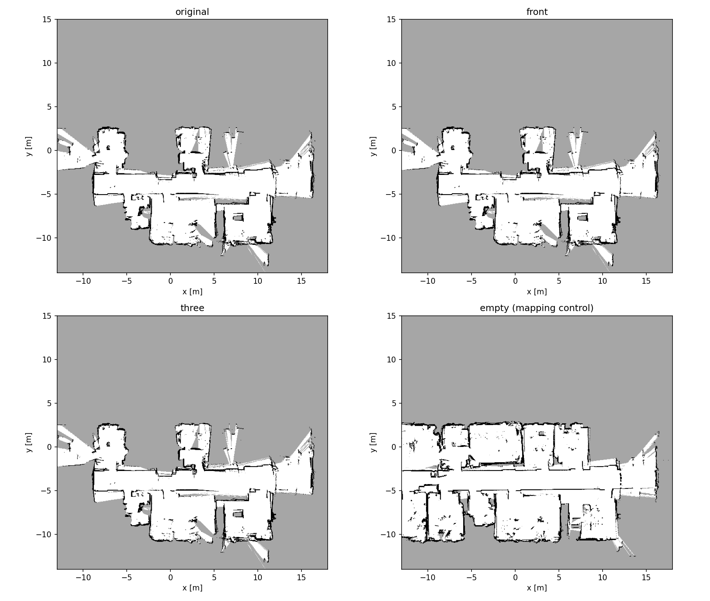
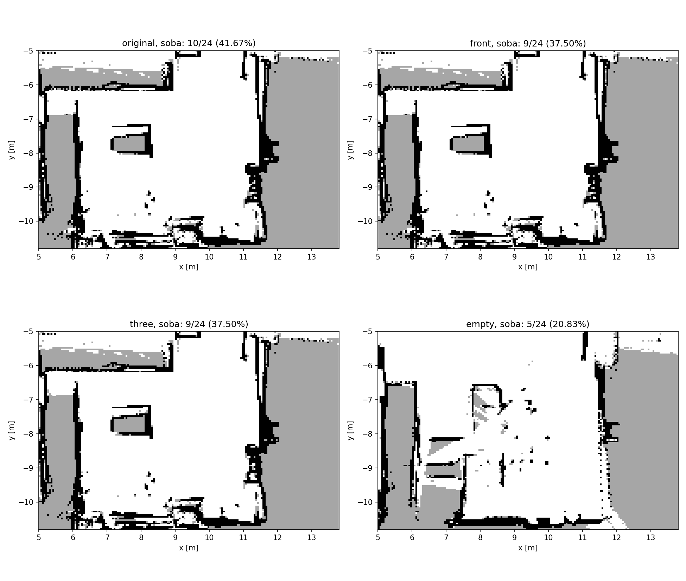
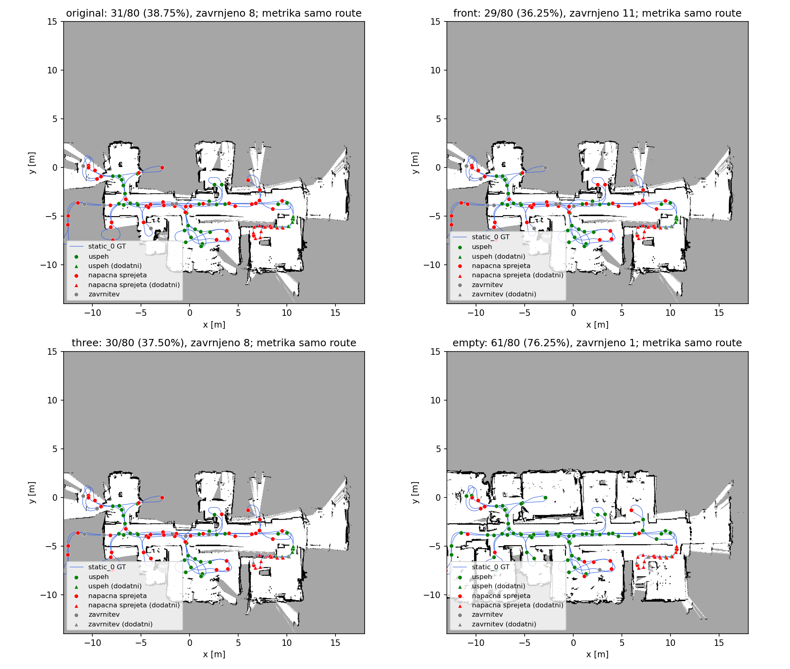
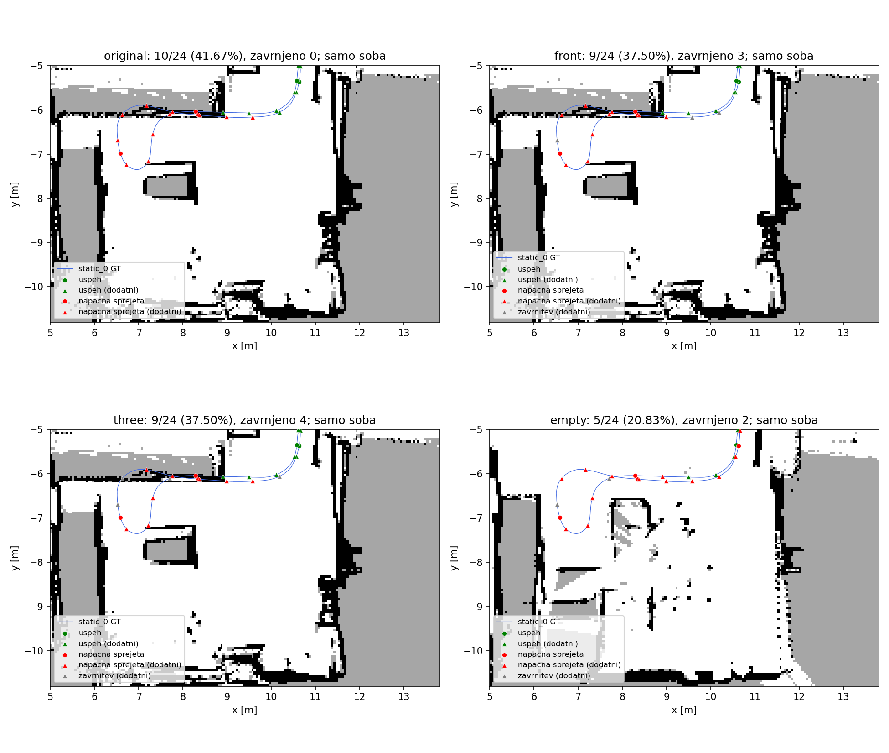
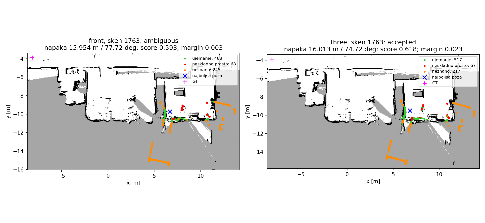
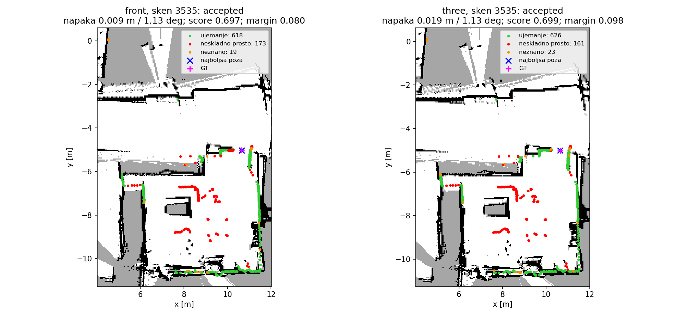
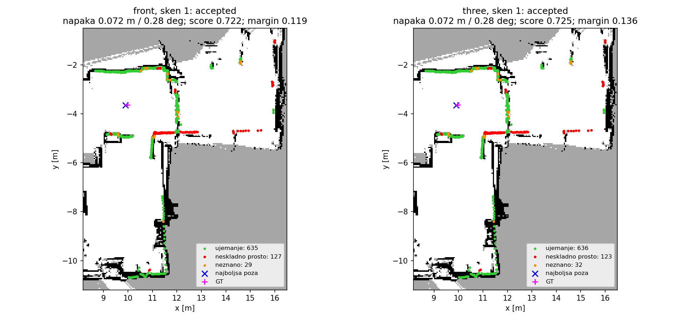

# Globalna lokalizacija iz enega LiDAR skena

Večločljivostni 2D correlative scan matching na štirih obstoječih 5 cm zemljevidih poskusa `86f7c57`. `original`, `front`, `three`: ista vožnja `lt_changes_0`; `empty`: neodvisni kontrolni `mapping`, osnovno stanje z običajnim pohištvom. Testni nefiltrirani skeni so samo iz `static_0`.

Vsak sken je obravnavan neodvisno. GT služi samo izboru po dolžini poti, oceni in risbam. Odometrija, prejšnje poze in GT niso vhod ujemanja; ni kompenzacije gibanja znotraj skena. Florence, Qwen, SAM in AMCL se ne zaganjajo. Obstoječa izvedba uporablja CPU NumPy/SciPy; GPU podpore nima.

## Vnaprej določeni protokol

80 determinističnih vzorcev enakomerno po dolžini poti. Če je med njimi manj kot 12 poz v sobi, dodamo do 20 sobnih vzorcev. Dodatni vzorci niso v metriki `route`; metrika `room` uporablja samo poze znotraj sobe iz obeh skupin. Izbor in časi so v [selected-scans.csv](selected-scans.csv), vse nastavitve v [config.json](config.json). Na izrisih so redni vzorci krogi, dodatni sobni vzorci trikotniki. To so **deleži uspešnih vzorčenih poz, ne deleži površine prostora**.

Isti dovoljeni pravokotnik [-13.0, -14.0, 18.0, 15.0] m je povzet iz prejšnjega prikaza celotnega zemljevida, brez omejevanja s kontrolnim zemljevidom ali testnimi GT pozami. Globalno: 0,5 m / 6°, vse orientacije; 48 prostorsko ločenih hipotez. Srednja raven: ±0,5 m / ±6°, korak 0,1 m / 1°; 16 hipotez. Fino: ±0,1 m / ±1°, korak 2,5 cm / 0,25°. Grobo 96, srednje 192, fino vsi veljavni zadetki (do 811). Enaka pravila za vse štiri različice. Deterministična enumeracija, stabilno razreševanje izenačenj; seme 42 je zabeleženo, naključnosti ni.

Polje razdalj in tri polja podpore se pripravijo enkrat na zemljevid ter uporabijo pri vseh skenih. Podpora je exp(−d²/(2σ²)) pri σ = 35 / 16 / 10 cm. Neznana celica ali zunaj mreže: nič podpore in nič kazni. Znani prosti prostor: omejena kazen 0,15·min(d/0,30 m, 1). Vse normaliziramo s številom **vseh** veljavnih zadetkov. Ujemanje: znan zadetek pri razdalji ≤10 cm; preostali znani zadetki so neskladni. Števila teh kategorij so v CSV.

Sprejem (zamrznjen pred tehničnim preizkusom in nespremenjen za polni test): ≥100 veljavnih zadetkov, ≥35 % ujemanj, ≥60 % znanih zadetkov, ocena ≥0,20 in razlika do naslednjega ločenega kandidata ≥0,01. Ločen kandidat pomeni ≥0,5 m ali ≥15°. Razlika je med ohranjenimi fino obdelanimi hipotezami, ne dokaz globalne enoličnosti. Najboljša poza se shrani tudi ob zavrnitvi.

Uspeh zahteva sprejem ter položaj <10 cm **in** zasuk <4°. Zavrnitve, napačne sprejete in manjkajoče ocene so neuspeh pri veljavnem GT. Za vse izbrane vzorce je GT na voljo. Čas na sken meri ujemanje po pripravi polj in pretvorbi koordinat žarkov; priprava zemljevida je ločena. Časi vključujejo iskanje vseh kandidatov in vse tri ravni.

## Rezultati

| Zemljevid / območje | Uspeh n/N (%) | Zavrnitve | Napačne sprejete | Mediana [s] | P95 [s] | Branje mreže [s] | Polje razdalj in podpora [s] |
|---|---:|---:|---:|---:|---:|---:|---:|
| original / route | 31/80 (38.75) | 8 | 41 | 2.182 | 2.327 | 0.0006 | 0.038 |
| original / room | 10/24 (41.67) | 0 | 14 | 2.171 | 2.258 | 0.0006 | 0.038 |
| front / route | 29/80 (36.25) | 11 | 40 | 2.016 | 2.081 | 0.0002 | 0.032 |
| front / room | 9/24 (37.50) | 3 | 12 | 1.995 | 2.038 | 0.0002 | 0.032 |
| three / route | 30/80 (37.50) | 8 | 42 | 2.028 | 2.089 | 0.0002 | 0.028 |
| three / room | 9/24 (37.50) | 4 | 11 | 2.003 | 2.043 | 0.0002 | 0.028 |
| empty / route | 61/80 (76.25) | 1 | 18 | 2.021 | 2.090 | 0.0002 | 0.031 |
| empty / room | 5/24 (20.83) | 2 | 17 | 1.990 | 2.038 | 0.0002 | 0.031 |

Tri kamere glede na sprednjo v tem determinističnem vzorcu **pomagajo**: razlika na poti +1.25 odstotne točke (29 → 30); v sobi +0.00 odstotne točke (9 → 9). Gre za en vnaprej določen nabor in eno izvedbo na različico; iz tega ne ocenjujemo statistične zanesljivosti ali uspešnosti sekvenčnega lokalizatorja.






Diagnostika: isti sken pri najboljši ocenjeni pozi na `front` in `three`; zelena = ujemanje, rdeča = neskladni znani prosti zadetki, oranžna = neznano. Modri križ je ocenjena poza, vijolični GT. Če ni razlike v sprejemu/uspehu, je izbran primer z največjo razliko ocen.




## Ponovitev

Iz korena repozitorija, ob obstoječem lokalnem cacheu (za ponovitev v drugo mapo spremeni `output` v kopiji konfiguracije):

```bash
OPENBLAS_NUM_THREADS=1 MPLCONFIGDIR=/tmp/mpl-lilocbench python3 maintenance/run_scan_to_map.py --stage smoke
OPENBLAS_NUM_THREADS=1 MPLCONFIGDIR=/tmp/mpl-lilocbench python3 maintenance/run_scan_to_map.py --stage full
```

Tehnični preizkus uporablja tri vnaprej določene skene (začetek, prva sobna poza, konec), preveri skupni nabor in izriše diagnostiko v lokalni cache. Polni preizkus zahteva uspešen tehnični preizkus iste kode in konfiguracije. Že končanega polnega preizkusa ne ponavlja. Veliki skeni, mreže in polja ostanejo lokalno.

[Meritve po pozah](poses.csv) · [Povzetek](summary.csv) · [Preverjanje in hashi](validation.csv). Številke tabele se programsko izpišejo iz istih povzetkov kot CSV. Osnovni podatki: LILocBench, Trekel et al., IROS 2025, CC BY-NC-SA 4.0.
