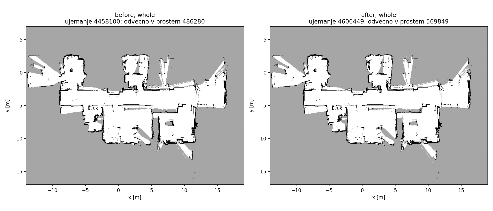
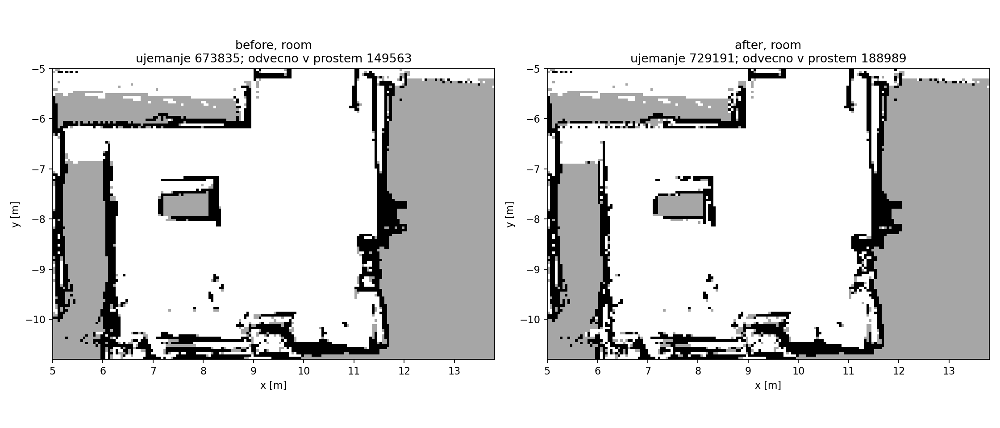
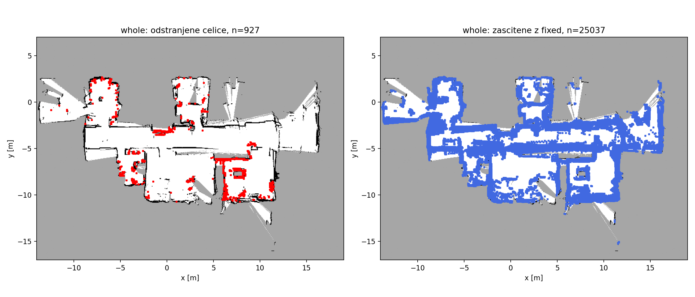
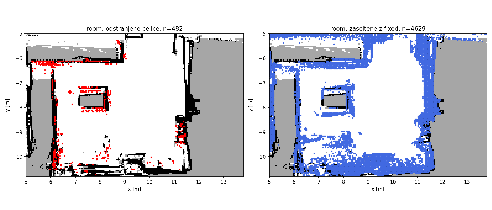
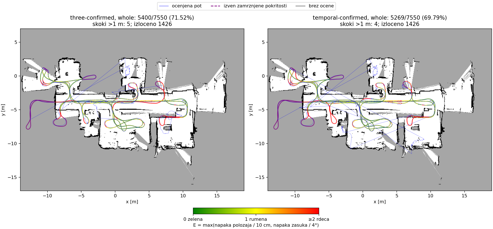
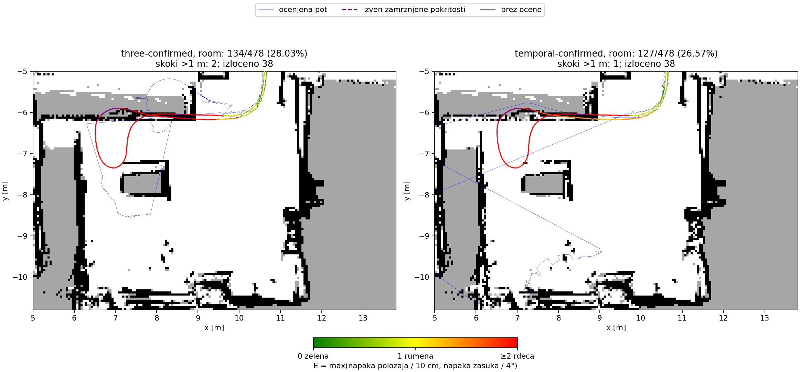

# Časovno združevanje semantičnih oznak po celicah

Izhodišče `695570a`. Florence → Qwen → SAM ostaja nespremenjen; uporabljene so shranjene maske, Qwen oznake, časovne asociacije in kalibracije vseh treh kamer. Brez nove inference. Nova mreža iz vseh istih 6540 skenov `lt_changes_0`, 5 cm, isti izvor, GT poze za gradnjo in ista integracija žarkov.

## Pravilo, zamrznjeno pred static_0

Celica potrebuje ≥3 neodvisne movable epohe, med njimi ≥0,5 s, in ≥2 različni kameri med sprejetimi epohami. Vsi žarki in kamere istega skena za isto celico skupaj štejejo največ eno epoho posameznega razreda. Kamere dajejo samo bitno evidenco pogledov, ne dodatnih časovnih glasov. Najmanj en veljaven fixed dokaz celico trajno zaščiti. Pravilo je konservativno in ni bilo izbrano glede na static_0.

Maskirana regija glasuje samo, če so vsi njeni izvorni Qwen razredi movable ali vsi fixed. Uncertain, manjkajoči in konfliktni razredi ne glasujejo. Čiste prekrivajoče regije se združijo; fixed ima prednost. Stari cache −1 ni fixed oznaka: združuje fixed, uncertain in manjkajoče. Zato so dejanski razredi obnovljeni iz shranjenih mask; iste časovne asociacije in UV projekcije so preverjene proti stari vidnosti. Vsaka uporabljena maska ima preverjen SHA256.

Gradnja je offline v dveh prehodih: najprej dokazovanje na celotni mapirni vožnji, nato odstranitev vseh zadetkov v potrjenih celicah brez fixed. Predhodna per-beam odstranitev se ne ohrani samodejno: novi filter jo nadomesti. Tudi zgodnejši zadetki take celice so odstranjeni šele v drugem prehodu. Izpuščen je celoten žarek, brez endpoint posodobitve ali prostega prostora za odstranjenim zadetkom. Drugi ohranjeni žarki lahko isti prostor še vedno opazujejo. Ne gre za sprotni filter.

Odstranjenih celic: **927**; fixed zaščitenih: **25037**; movable potrjenih, a zaščitenih s fixed: **4093**. Prejšnji filter odstrani 311199 surovih zadetkov, novi 79098. Vse tri kamere prispevajo veljavne dokaze. [Revizija](map-audit.json), [dokazi po celicah](cell-evidence.csv), [zamrznjeni mapirni protokol](map-protocol.json). Ponovno zgrajena nefiltrirana kontrola je celico za celico enaka izvirniku.

## Geometrija proti neodvisnemu mapping

Razdalja ≤10 cm med zveznimi konci LiDAR žarkov. Odvečen zadetek mora biti neujemajoč in ležati v referenčno potrjenem prostem prostoru. Neopaženo je ločena kategorija. Imenovalci so zadetki, ne deduplicirane celice; soba pomeni koordinate endpointov v istem vnaprej določenem pravokotniku.

| Zemljevid / območje | Ohranjeni zadetki | Ujemajoči n (%) | Odvečni v prostem n (%) | Neopaženi |
|---|---:|---:|---:|---:|
| before / whole | 4967857 | 4458100 (89.74) | 486280 (9.79) | 21319 |
| after / whole | 5199397 | 4606449 (88.60) | 569849 (10.96) | 20944 |
| before / room | 840801 | 673835 (80.14) | 149563 (17.79) | 15342 |
| after / room | 935454 | 729191 (77.95) | 188989 (20.20) | 15220 |

| Območje | Izginili odvečni | Ponovno vključeni odvečni | Neto manj odvečnih | Stari ujemajoči ostali n (%) | Stari ujemajoči odstranjeni |
|---|---:|---:|---:|---:|---:|
| whole | 13675 | 97244 | -83569 | 4415813 (99.05) | 42287 |
| room | 9031 | 48457 | -39426 | 658960 (97.79) | 14875 |

Negativno »neto manj« pomeni povečanje odvečne geometrije. Ločeno štetje ponovnih vključitev prepreči, da bi prikazali samo ugodne odstranitve. Podrobnosti: [geometry.csv](geometry.csv), [parne spremembe](geometry-effects.csv).






## Lokalizacija, ista pokritost in nastavitve

Predvajanje vseh 8982 nefiltriranih `static_0` skenov po vrsti, brez resetov ob vstopu v pokritost. Isti večločljivostni matcher, kolesna odometrija, pet zaporednih podpor za potrditev oddaljenega predloga in vse nastavitve iz `695570a`. GT je samo za evalvacijo in risanje. Stari `three-confirmed` zagon se ponovno uporabi po preverjanju kode, nastavitev, mreže in skenov. Nova različica: tehnični preizkus 120 skenov in en celoten zagon; brez izbora semena ali ponavljanja zaradi rezultata.

Glavna maska je nespremenjeni presek iz `695570a`; **7550** istih referenčnih poz za celotno pot in **478** za sobo. Izločeno je 1426 nezmapiranih GT poz, od teh 38 v sobi; 6 skenov nima GT. Nova mreža maske ne spremeni. Uspeh zahteva položaj <10 cm in zasuk <4°, tudi pri negotovi odometrijski napovedi; `confident_n` je sekundarno število brez negotovih. Manjkajoče ocene so neuspeh. P95 je nad razpoložljivimi ocenami v maski. Skoki >1 m zahtevajo obe sosednji GT pozi v isti zamrznjeni maski.

| Zemljevid / območje | Uspeh n/N (%) | P95 položaj [cm] | P95 zasuk [°] | Skoki >1 m |
|---|---:|---:|---:|---:|
| three-confirmed / whole | 5400/7550 (71.52) | 309.84 | 8.27 | 5 |
| three-confirmed / room | 134/478 (28.03) | 258.28 | 108.54 | 2 |
| temporal-confirmed / whole | 5269/7550 (69.79) | 470.07 | 89.90 | 4 |
| temporal-confirmed / room | 127/478 (26.57) | 1158.68 | 97.21 | 1 |

Na skupno pokritih pozah (whole) časovno združevanje spremeni uspeh za **-1.74 odstotne točke**, P95 položaja 309.84 → 470.07 cm in skoke 5 → 4. To je en parni preizkus; ne ocenjuje statistične zanesljivosti.

Na skupno pokritih pozah (room) časovno združevanje spremeni uspeh za **-1.46 odstotne točke**, P95 položaja 258.28 → 1158.68 cm in skoke 2 → 1. To je en parni preizkus; ne ocenjuje statistične zanesljivosti.




E = max(napaka položaja/10 cm, napaka zasuka/4°): zelena 0, rumena 1, rdeča ≥2; siva brez ocene. Vijolično črtkano: izven iste zamrznjene pokritosti; tanka modra: celotna ocenjena pot. Barva segmenta uporabi največji E koncev.

[Meritve po pozah](poses.csv) · [Lokalizacijska tabela](localization.csv) · [Potrditve](confirmation-events.csv) · [Preverjanje](validation.json). Native 5 cm PNG/YAML izvoza sta v `maps/before` in `maps/after`, z ohranjeno razliko occupied/free/unknown.

## Ponovitev

Iz korena repozitorija z obstoječimi lokalnimi maskami/cacheom in podatki iz `695570a`:

```bash
OPENBLAS_NUM_THREADS=1 MPLCONFIGDIR=/tmp/mpl-lilocbench python3 maintenance/run_temporal_cells.py --stage build
OPENBLAS_NUM_THREADS=1 MPLCONFIGDIR=/tmp/mpl-lilocbench python3 maintenance/run_temporal_cells.py --stage smoke
OPENBLAS_NUM_THREADS=1 MPLCONFIGDIR=/tmp/mpl-lilocbench python3 maintenance/run_temporal_cells.py --stage full
```

Nastavitve: `configs/lilocbench-temporal-cells.json`. Lokalni vmesni podatki: `data/lilocbench-temporal-cells`; velike projekcije in raw skeni niso dodani v Git. Polni zagon se ob obstoječi končni tabeli ne ponovi. Za novo ponovitev uporabi novo izhodno/cache mapo. Seme 42, deterministična izvedba na CPU, brez inference. LILocBench: Trekel et al., IROS 2025, CC BY-NC-SA 4.0.

Neodvisno preverjanje: `OPENBLAS_NUM_THREADS=1 python3 maintenance/validate_temporal_cells.py`. Preveri glasove, abstinenco manjkajočih mask, native izvoze, geometrijo, isto pokritost, oba CSV ter nespremenjeno odometrijo in baseline.

Sklep za dopolnitev PDF: pri teh vnaprej zamrznjenih pragih časovno združevanje ne izboljša skupne uspešnosti (71.52 → 69.79 %). Ohrani 99.05 % prej ujemajočih se zadetkov, toda ponovno vključi več odvečne geometrije, kot je dodatno odstrani. Manj skokov ne odtehta slabšega P95 položaja. [Združena tabela prej–potem za PDF](before-after.csv).
