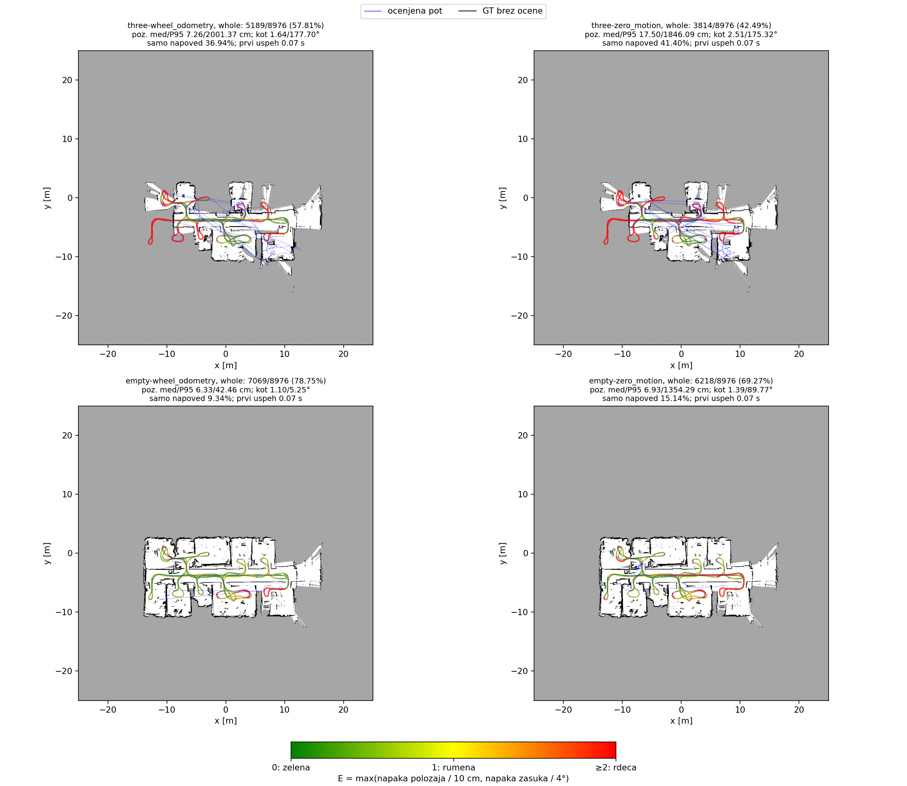
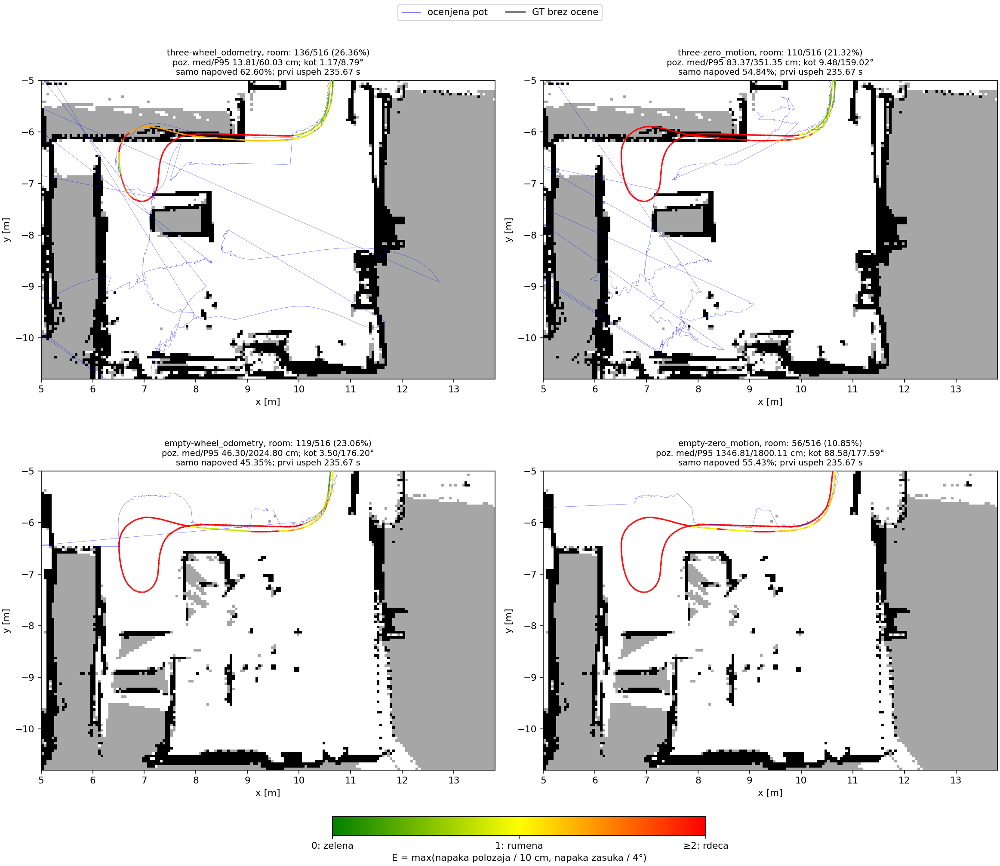

# Sekvenčno globalno iskanje in sledenje LiDAR

Nadgradnja matcherja iz `ba62e13`. Vsi skeni `static_0` v časovnem vrstnem redu, isti nefiltrirani LiDAR, zemljevida `three` (tri kamere, `lt_changes_0`) in `empty` (neodvisni osnovni `mapping` z običajnim pohištvom). Na vsakem en zagon z relativnimi premiki kolesne odometrije in en z ničelnimi premiki. Brez gradnje zemljevidov, modelov ali AMCL.

Začetna poza je neznana. Globalno iskanje uporablja isto mrežo položajev in vseh zasukov kot prejšnji matcher, brez GT. Za sprejem zahteva ≥100 zadetkov, ≥45 % ujemanj, ≥70 % znanih zadetkov, score ≥0,35 in razliko ločene hipoteze ≥0,03. Po sprejemu napoved v SE(2) uporablja samo relativni premik med sosednjima odometrijskima pozama. V načinu `zero_motion` funkcija vrne ničle pred branjem izmerjenih razlik; ničelnost je preverjena in premiki so v CSV.

Lokalno: ±24 cm / ±6°, korak 8 cm / 2°, 192 žarkov; tri ločene hipoteze, nato ±4 cm / ±1°, korak 2 cm / 0,5°, 256 žarkov. Končna izbira in preverjanje na vseh veljavnih žarkih. Ambigvnost preverimo tudi s šestimi odmiki ±12 cm oziroma ±3°. Lokalni sprejem: ≥40 % ujemanj, ≥60 % znanih, score ≥0,25, margin ≥0,01 in ≥100 zadetkov. Neznano ne daje podpore; kazen v prostem ostane omejena kot prej.

Ob zavrnitvi se LiDAR popravek preskoči; objavi se samo napoved in stanje `prediction_only`. V ničelnem načinu to pomeni nespremenjeno zadnjo pozo, ne izmerjene odometrije. Po treh sekundah brez sprejetega LiDAR popravka poskusimo ponovno globalno; med globalnimi poskusi je najmanj tri sekunde. Dokler ni prvega sprejema, ocene ni. Globalni neuspeh ob že obstoječi pozi ohrani napoved; lokalna ponovna pridobitev lahko prekine izgubo. GT ne vpliva na sprejem, izgubo ali izbiro kandidata.

GT je samo za vrednotenje in risanje. Uspeh: položaj <10 cm in zasuk <4°, tudi pri napovednih pozah. Manjkajoča ocena ob GT je neuspeh. Mediana/P95 napak veljata za razpoložljive ocene z GT; manjkajoče so posebej preštete. Delež samo napovedi ima imenovalec vse poze z GT v območju, vključno z manjkajočimi ocenami. Čas prve pravilne poze je čas posnetka od prvega skena, za sobo prav tako od začetka posnetka. CSV doda število skenov in seštevek procesnega časa do tega trenutka. Pomanjkanje GT je izločeno in navedeno v reviziji.

Seme 42, brez naključnih korakov. Štirje ločeni CPU procesi (4 sočasni delavci), ista koda in nastavitve; vsak obdeluje skene zaporedno. Časi vključujejo pretvorbo žarkov in lokalno/globalno ujemanje, brez enkratne priprave polj. Ni kompenzacije skena z odometrijo. Soba: [5.0, -10.8, 13.8, -5.0] m.

| Kombinacija / območje | Uspeh n/N (%) | Položaj med/P95 [cm] | Zasuk med/P95 [°] | Prvi pravilen [s] | Samo napoved [%] | Manjkajoče |
|---|---:|---:|---:|---:|---:|---:|
| three-wheel_odometry / whole | 5189/8976 (57.81) | 7.26/2001.37 | 1.64/177.70 | 0.07 | 36.94 | 0 |
| three-wheel_odometry / room | 136/516 (26.36) | 13.81/60.03 | 1.17/8.79 | 235.67 | 62.60 | 0 |
| three-zero_motion / whole | 3814/8976 (42.49) | 17.50/1846.09 | 2.51/175.32 | 0.07 | 41.40 | 0 |
| three-zero_motion / room | 110/516 (21.32) | 83.37/351.35 | 9.48/159.02 | 235.67 | 54.84 | 0 |
| empty-wheel_odometry / whole | 7069/8976 (78.75) | 6.33/42.46 | 1.10/5.25 | 0.07 | 9.34 | 0 |
| empty-wheel_odometry / room | 119/516 (23.06) | 46.30/2024.80 | 3.50/176.20 | 235.67 | 45.35 | 0 |
| empty-zero_motion / whole | 6218/8976 (69.27) | 6.93/1354.29 | 1.39/89.77 | 0.07 | 15.14 | 0 |
| empty-zero_motion / room | 56/516 (10.85) | 1346.81/1800.11 | 88.58/177.59 | 235.67 | 55.43 | 0 |

Na zemljevidu `three` izmerjena odometrija spremeni uspešnost za +15.32 odstotne točke. To je ena parna izvedba, ne ocena statistične zanesljivosti.

Na zemljevidu `empty` izmerjena odometrija spremeni uspešnost za +9.48 odstotne točke. To je ena parna izvedba, ne ocena statistične zanesljivosti.




GT je obarvan po E: zelena pri 0, rumena pri 1, rdeča pri ≥2, siva brez ocene. Barva segmenta je največji E njegovih koncev. Tanka modra je ocenjena pot, tudi med odometrijsko napovedjo. Ob manjkajočem GT so odseki prekinjeni.

[Vse poze in prehodi stanj](poses.csv) · [Povzetek](summary.csv) · [Nastavitve](config.json) · [Revizija](validation.csv).

## Ponovitev

```bash
OPENBLAS_NUM_THREADS=1 MPLCONFIGDIR=/tmp/mpl-lilocbench python3 maintenance/run_sequential_scan_to_map.py --stage smoke
OPENBLAS_NUM_THREADS=1 MPLCONFIGDIR=/tmp/mpl-lilocbench python3 maintenance/run_sequential_scan_to_map.py --stage full
```

Potrebni lokalni vhodi: `data/lilocbench-filtered-map/static_0/raw.npz`, `raw.json`, `data/lilocbench-pilot/static_0/transformations.yaml`, `results/lilocbench-reverse/maps/{three,empty}/occupancy.npy`; izvor in merilo določa osnovna konfiguracija. Potrebni Python paketi: NumPy, SciPy, PyYAML, Matplotlib. Uporabljeni pomožni moduli so v repozitoriju. Podatki LILocBench, Trekel et al., IROS 2025, CC BY-NC-SA 4.0.

Polni zagon se ne ponavlja, če obstajajo končni rezultati; za novo ponovitev uporabi kopijo konfiguracije z drugim `output` in `cache`. Tehnični preizkus uporabi prvih 120 skenov vseh kombinacij in zamrzne hash kode in nastavitev. [Inventar in kandidati za ločen pregled čiščenja](INVENTORY.md). Brisanje ni bilo izvedeno.
